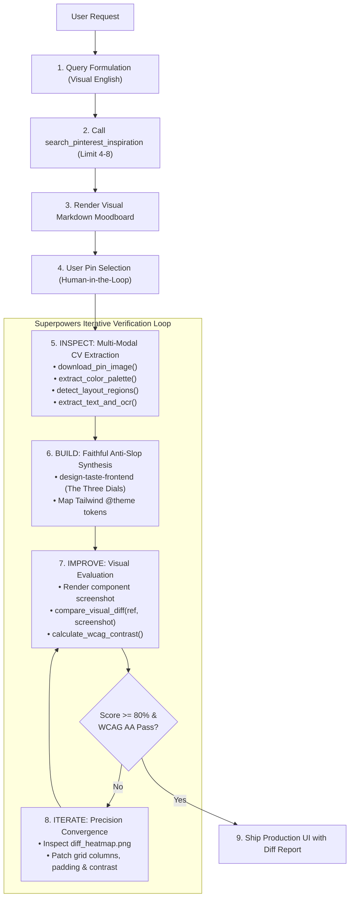

# AGENTS.md — Universal Agent Operating Guidelines

This document provides context, tool signatures, bundled skills, and operational workflows for AI coding agents (**Google Antigravity**, **Claude Code**, **OpenAI Codex**, **Cursor**, and **Windsurf**) working with or utilizing the **Pinterest Inspiration Plugin**.

---

## 1. Project Purpose & Architecture

The **Pinterest Inspiration Plugin** is a zero-configuration, zero-API-key, and zero-browser-dependency visual inspiration and design-to-code engine. It combines real-time Pinterest visual scraping with bundled UI/UX design intelligence skills.

- **Scraper Engine (`src/pinterest_scraper.py`):** Uses mobile Safari User-Agent SSR to parse `<script id="__PWS_INITIAL_PROPS__">` JSON, delivering top pins (<800ms) with original HD images, preview URLs, dominant hex colors, and aspect ratios.
- **FastMCP Server (`src/server.py`):** Exposes standardized MCP tools over stdio (local) and SSE (remote/Docker).
- **Bundled Agent Skills (`skills/`):**
  1. `skills/pinterest-inspiration`: Core visual inspiration, moodboards, and token extraction.
  2. `skills/design-taste-frontend`: Comprehensive anti-slop frontend taste skill (The Three Dials, Design Read, font pairings, layout variance, non-templated interfaces).
  3. `skills/web-design-guidelines`: Vercel-standard accessibility, keyboard focus, WCAG 4.5:1 contrast, semantic HTML, and CLS prevention.
- **Cross-Agent Manifests:** `plugin.json`, `gemini-extension.json`, `mcp_config.json`, `mcp.json`, `.claude-plugin/plugin.json`.

---

## 2. Exposed MCP Tools

### `search_pinterest_inspiration(query: str, limit: int = 8)`
Searches Pinterest for visual references matching `query` and returns up to 10 pins.

- **Parameters:**
  - `query` (`string`, required): Descriptive visual keywords in English (e.g. `minimalist brutalist dashboard ui`, `cyberpunk neon editorial photography`).
  - `limit` (`integer`, optional, default: 8): Number of inspirations to return (clamped between 1 and 10).
- **Return Fields per Pin:**
  - `id`: Pinterest Pin ID.
  - `dominant_color`: Normalized hex code (e.g. `#1a202c`).
  - `aspect_ratio`: Float width/height ratio.
  - `image_url`: Highest-resolution original image URL (`orig`).
  - `preview_url`: Web-optimized preview URL (`736x`).
  - `width` & `height`: Dimensions in pixels.
  - `query`: The search keyword.

### `download_pin_image(image_url: str, output_path: str = '')`
Downloads an inspiration image to local storage for multi-modal vision inspection or direct project asset usage.

- **Parameters:**
  - `image_url` (`string`, required): Direct image URL obtained from `search_pinterest_inspiration`.
  - `output_path` (`string`, optional): Destination file or directory path. Defaults to `.pinterest_cache/<hash>.jpg`.
- **Return Value:**
  - Absolute local file path of the downloaded image.

### `extract_color_palette(image_path_or_url: str, num_colors: int = 5)`
Extracts a full quantized color palette, relative luminance, 60-30-10 semantic roles, and WCAG contrast analysis from any local image or Pinterest image URL using Pillow median-cut quantization.

- **Parameters:**
  - `image_path_or_url` (`string`, required): Local file path or HTTP/HTTPS image URL.
  - `num_colors` (`integer`, optional, default: 5): Number of quantized colors to extract (3 to 10).
- **Return Value:**
  - Dict containing total colors, `canvas_ground_60`, `surface_structure_30`, `high_impact_accent_10`, list of palette colors with frequency percentages and relative luminance, contrast matrix against the canvas, and ready-to-paste Tailwind CSS `@theme` snippet.

### `calculate_wcag_contrast(foreground_hex: str, background_hex: str)`
Calculates the exact WCAG 2.1 relative luminance and contrast ratio between any two hex colors.

- **Parameters:**
  - `foreground_hex` (`string`, required): Text or foreground color hex (e.g. `#FFFFFF` or `#F3F4F6`).
  - `background_hex` (`string`, required): Surface or background color hex (e.g. `#0B0D10`).
- **Return Value:**
  - Dict with contrast ratio (e.g. `17.6:1`), compliance flags for AA/AAA normal and large text, and graphical component status (`AAA_ENHANCED`, `AA_COMPLIANT`, `FAIL`).

### `extract_text_and_ocr(image_path_or_url: str)`
Extracts raw text, numerical metrics, headings, and navigation labels from reference pins using Tesseract OCR.

- **Parameters:**
  - `image_path_or_url` (`string`, required): Local image path or direct image URL.
- **Return Value:**
  - Dict with `raw_text`, non-empty `lines`, `numerical_metrics` (e.g. `$30,240`, `129`, `24%`, `14d`), `detected_headings`, and `detected_navigation`.

### `detect_layout_regions(image_path_or_url: str)`
Analyzes image geometry via horizontal and vertical luminance projections to detect structural UI regions (sidebar, header, content canvas bounding box, and estimated card grid columns).

- **Parameters:**
  - `image_path_or_url` (`string`, required): Local file path or HTTP/HTTPS image URL.
- **Return Value:**
  - Dict containing:
    - `sidebar_detected`: bool (True if a distinct vertical navigation column exists on left)
    - `sidebar_width_pct`: float (e.g. `18.5`)
    - `header_detected`: bool (True if top navigation bar is detected)
    - `header_height_px`: int (e.g. `64`)
    - `main_grid_bounding_box`: `[x, y, w, h]` (pixel coordinates of primary content canvas)
    - `estimated_card_columns`: int (estimated grid column count: 2, 3, or 4)
    - `analysis`: text explanation of detected UI layout geometry.

### `compare_visual_diff(reference_image_path_or_url: str, rendered_screenshot_path: str, threshold: float = 80.0)`
Performs automated computer-vision visual difference evaluation between a reference design pin and a rendered UI screenshot. Generates a visual diff heatmap.

- **Parameters:**
  - `reference_image_path_or_url` (`string`, required): Reference pin image path or URL.
  - `rendered_screenshot_path` (`string`, required): Path to rendered UI screenshot image.
  - `threshold` (`float`, optional, default: `80.0`): Similarity percentage threshold (0.0 to 100.0) required to pass.
- **Return Value:**
  - Dict containing:
    - `similarity_score_pct`: float (e.g. `87.4`)
    - `threshold`: float (e.g. `80.0`)
    - `passed`: bool (`True` if similarity >= threshold)
    - `diff_image_path`: str (path to generated heatmap image, e.g. `.pinterest_cache/diff_heatmap.png`)
    - `analysis`: detailed breakdown of spatial and color discrepancies.

---

## 3. Bundled Skills & Superpowers Iterative Verification Loop

When a user asks for UI design, moodboards, branding, or AI image creation:

1. **Query Translation:** Convert user requests into descriptive visual English search terms.
   - *Example:* "Make a minimalist artisanal coffee roastery website" → `"artisanal coffee shop website ui editorial warm earthy"`
2. **Visual Retrieval:** Call `search_pinterest_inspiration(query=..., limit=6)`.
3. **Present Moodboard:** Display an aesthetic Markdown moodboard with clickable preview images, numbered labels, and dominant color hex badges.
4. **User Pin Selection (Human-in-the-Loop):** Prompt the user to select their preferred pin reference to anchor the design direction on.
5. **Multi-Modal Inspection (INSPECT):**
   - Download the selected pin via `download_pin_image()`.
   - Run `extract_color_palette()` to derive the 60-30-10 palette (`canvas_ground_60`, `surface_structure_30`, `high_impact_accent_10`).
   - Run `detect_layout_regions()` to detect sidebar width %, header height, and card column count.
   - Run `extract_text_and_ocr()` to extract real metrics (`$30,240`, `129`, `24%`) and navigation labels.
6. **Faithful Visual Replication (`design-taste-frontend`):**
   - Output a one-line Design Read: `"Reading this as: <page kind> for <audience>, with a <vibe> language, leaning toward <aesthetic family>."`
   - Set the dials: `DESIGN_VARIANCE`, `MOTION_INTENSITY`, `VISUAL_DENSITY` (e.g., `7 / 6 / 8`).
   - Eliminate AI tells: No purple gradients, no generic Inter+slate-900, no cookie-cutter centered cards.
   - Build UI components using the detected layout regions and tokens.
7. **Closed-Loop Visual Diffing (IMPROVE):**
   - Render a screenshot of the built UI component.
   - Run `compare_visual_diff(reference_image, screenshot, threshold=80.0)`.
   - Run `calculate_wcag_contrast()` on text vs surfaces to verify accessibility compliance.
8. **Precision Convergence (ITERATE):**
   - If similarity < 80% or contrast fails, inspect `.pinterest_cache/diff_heatmap.png` to find misalignments.
   - Patch layout parameters and re-verify until convergence.

---

## 4. Development & Testing Commands

- **Install dependencies:** `uv sync`
- **Run test suite:** `uv run pytest`
- **Run test with output:** `uv run pytest -v`
- **Start MCP Server directly:** `uv run python -m src.server`
