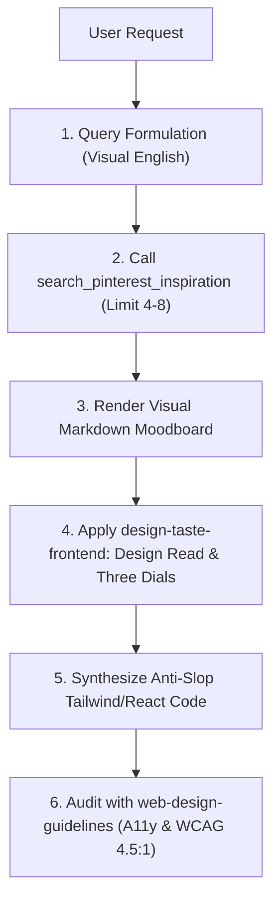

# AGENTS.md — Universal Agent Operating Guidelines

This document provides context, tool signatures, bundled skills, and operational workflows for AI coding agents (**Google Antigravity**, **Claude Code**, **OpenAI Codex**, **Cursor**, and **Windsurf**) working with or utilizing the **Pinterest Inspiration Plugin**.

---

## 1. Project Purpose & Architecture

The **Pinterest Inspiration Plugin** is a zero-configuration, zero-API-key, and zero-browser-dependency visual inspiration and design-to-code engine. It combines real-time Pinterest visual scraping with bundled UI/UX design intelligence skills.

- **Scraper Engine (`src/pinterest_scraper.py`):** Uses mobile Safari User-Agent SSR to parse `<script id="__PWS_INITIAL_PROPS__">` JSON, delivering top pins (<800ms) with original HD images, preview URLs, dominant hex colors, and aspect ratios.
- **FastMCP Server (`src/server.py`):** Exposes standardized MCP tools over stdio (local) and SSE (remote/Docker).
- **Bundled Agent Skills (`skills/`):**
  1. `skills/pinterest-inspiration`: Core visual inspiration, moodboards, and token extraction.
  2. `skills/design-taste-frontend`: Comprehensive anti-slop frontend taste skill (The Three Dials, Design Read, font pairings, layout variance, non-templated interfaces).
  3. `skills/web-design-guidelines`: Vercel-standard accessibility, keyboard focus, WCAG 4.5:1 contrast, semantic HTML, and CLS prevention.
- **Cross-Agent Manifests:** `plugin.json`, `gemini-extension.json`, `mcp_config.json`, `mcp.json`, `.claude-plugin/plugin.json`.

---

## 2. Exposed MCP Tools

### `search_pinterest_inspiration(query: str, limit: int = 8)`
Searches Pinterest for visual references matching `query` and returns up to 10 pins.

- **Parameters:**
  - `query` (`string`, required): Descriptive visual keywords in English (e.g. `minimalist brutalist dashboard ui`, `cyberpunk neon editorial photography`).
  - `limit` (`integer`, optional, default: 8): Number of inspirations to return (clamped between 1 and 10).
- **Return Fields per Pin:**
  - `id`: Pinterest Pin ID.
  - `dominant_color`: Normalized hex code (e.g. `#1a202c`).
  - `aspect_ratio`: Float width/height ratio.
  - `image_url`: Highest-resolution original image URL (`orig`).
  - `preview_url`: Web-optimized preview URL (`736x`).
  - `width` & `height`: Dimensions in pixels.
  - `query`: The search keyword.

### `download_pin_image(image_url: str, output_path: str = '')`
Downloads an inspiration image to local storage for multi-modal vision inspection or direct project asset usage.

- **Parameters:**
  - `image_url` (`string`, required): Direct image URL obtained from `search_pinterest_inspiration`.
  - `output_path` (`string`, optional): Destination file or directory path. Defaults to `.pinterest_cache/<hash>.jpg`.
- **Return Value:**
  - Absolute local file path of the downloaded image.

---

## 3. Bundled Skills & Design Workflow

When a user asks for UI design, moodboards, branding, or AI image creation:

1. **Query Translation:** Convert user requests into descriptive visual English search terms.
   - *Example:* "Make a minimalist artisanal coffee roastery website" → `"artisanal coffee shop website ui editorial warm earthy"`
2. **Visual Retrieval:** Call `search_pinterest_inspiration(query=..., limit=6)`.
3. **Present Moodboard:** Display an aesthetic Markdown moodboard with clickable preview images and dominant color hex badges.
4. **Design Read & The Three Dials (`design-taste-frontend`):**
   - Output a one-line Design Read: `"Reading this as: <page kind> for <audience>, with a <vibe> language, leaning toward <aesthetic family>."`
   - Set the dials: `DESIGN_VARIANCE`, `MOTION_INTENSITY`, `VISUAL_DENSITY` (e.g., `8 / 6 / 4`).
   - Eliminate AI tells: No purple gradients, no generic Inter+slate-900, no cookie-cutter centered cards.
5. **Color & Layout Synthesis:**
   - Map Pinterest `dominant_color` hex codes to the 60-30-10 palette rule (Canvas, Structure, Accent).
   - Pair display serif/grotesque fonts with clean body typography.
6. **Accessibility Audit (`web-design-guidelines`):**
   - Verify WCAG AA 4.5:1 contrast against surfaces.
   - Enforce visible `:focus-visible` rings, semantic `<button>` / `<a>` tags, skip links, and explicit image dimensions.

---

## 4. Development & Testing Commands

- **Install dependencies:** `uv sync`
- **Run test suite:** `uv run pytest`
- **Run test with output:** `uv run pytest -v`
- **Start MCP Server directly:** `uv run python -m src.server`
