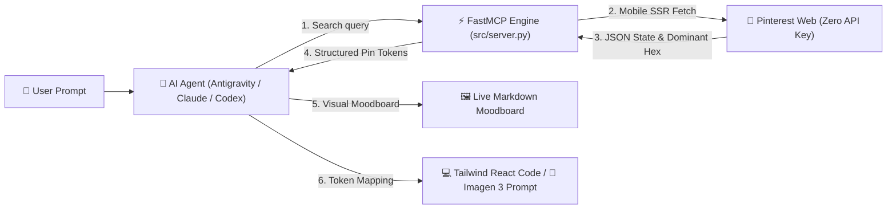

# 🎨 Pinterest Inspiration Plugin

> **Universal Visual Inspiration Engine & Design-to-Code MCP Plugin for AI Agents**  
> Battle-tested for **Google Antigravity**, **Claude Code**, **OpenAI Codex**, and **Cursor / Windsurf**.

[](https://github.com/khanhnkq/pinterest-inspired-plugin/actions)
[](https://modelcontextprotocol.io)
[](https://www.python.org/)
[](https://github.com/khanhnkq/pinterest-inspired-plugin/pkgs/container/pinterest-inspired-plugin)
[](https://github.com/jlowin/fastmcp)
[](LICENSE)

---

## 📖 Table of Contents
- [Overview](#-overview)
- [Why This Plugin? (Anti-Generic AI)](#-why-this-plugin-anti-generic-ai)
- [Key Features](#-key-features)
- [Architecture & Mechanics](#-architecture--mechanics)
- [MCP Tools Specification](#-mcp-tools-specification)
- [End-to-End Real World Workflows](#-end-to-end-real-world-workflows)
  - [Workflow 1: UI/UX & Tailwind CSS Frontend](#workflow-1-uiux--tailwind-css-frontend)
  - [Workflow 2: AI Image Generation (Midjourney / Imagen 3)](#workflow-2-ai-image-generation-midjourney--imagen-3)
- [Agent Platform Setup Guides](#-agent-platform-setup-guides)
  - [1. Google Antigravity](#1-google-antigravity-setup-one-command)
  - [2. Claude Code](#2-claude-code-setup)
  - [3. Cursor & Windsurf](#3-cursor--windsurf-setup)
  - [4. OpenAI Codex](#4-openai-codex-setup)
- [Production Deployment (Azure VM & Docker)](#-production-deployment-azure-vm--docker)
- [Testing & Quality Assurance](#-testing--quality-assurance)
- [License & Contributing](#-license)

---

## 🌟 Overview

The **Pinterest Inspiration Plugin** bridges the gap between text-based AI models and real-world aesthetic references. 

Instead of guessing generic UI colors or hallucinating vague art styles, AI coding agents can now query Pinterest's infinite visual repository, extract precise visual design tokens (**high-resolution images**, **dominant hex colors**, **aspect ratios**, **dimensions**), construct aesthetic moodboards, and synthesize production-grade code or generative prompts.



---

## 🚫 Why This Plugin? (Anti-Generic AI)

When LLMs write frontend code or generate images from text alone, they frequently fall back to predictable, repetitive tropes (*"purple gradients"*, *"generic rounded cards"*, *"flat robotic UI"*).

By feeding live Pinterest visual tokens into the Agent's reasoning loop:
1. **Accurate Color Extraction:** Uses Pinterest's native `dominant_color` hex codes (e.g. `#2C1E17`, `#F4EBD9`) directly in Tailwind CSS palettes.
2. **Real-world Layout References:** Visual tokens preserve aspect ratios and real-world editorial arrangements (Bento grids, brutalist typography, asymmetric cards).
3. **Deconstructed Prompts:** Converts textures, camera angles, and lighting setups into structured Midjourney and Gemini Imagen 3 parameters.

---

## ⚡ Key Features

- **Zero API Keys & Zero Credentials:** Uses modern Mobile Safari SSR scraping to parse Pinterest's `<script id="__PWS_INITIAL_PROPS__">` JSON state. No developer accounts, OAuth approvals, or API fees required.
- **Zero Headless Browser Overhead:** No Puppeteer, Chromium, or Playwright binaries. Pure, ultra-fast Python HTTP parsing (< 800ms per request).
- **Hard Clamped Results:** Intelligently capped at $\le 10$ pins per query to prevent LLM context-window bloating and avoid Pinterest rate-limiting.
- **Local Asset Caching:** Downloads original high-res images directly into `.pinterest_cache/` for multimodal Vision inspection by the Agent.
- **Multi-Agent Cross-Compatibility:** Includes native manifests for Antigravity (`plugin.json`, `gemini-extension.json`), Claude Code (`.claude-plugin/plugin.json`, `CLAUDE.md`), and Codex/Cursor (`AGENTS.md`, `mcp.json`).
- **Production-Ready Remote Deployment:** Pre-configured Docker container and automated GitHub Actions CI/CD deploying to Azure VM via GHCR.

---

## 🛠️ MCP Tools Specification

The plugin exposes standard JSON-RPC 2.0 MCP tools over `stdio` (Local) and `sse` (Remote):

### 1. `search_pinterest_inspiration`
Searches Pinterest for visual references and extracts essential design tokens.

- **Parameters:**
  - `query` (`string`, required): Descriptive visual keywords (e.g. `"minimalist handcrafted ceramic pottery editorial landing page"`).
  - `limit` (`integer`, optional, default: `8`, max: `10`): Number of visual inspirations to return.
- **Output Schema:**
  ```json
  [
    {
      "id": "e1_AfqPShwFa3RQJrodLyiFh...",
      "dominant_color": "#F4EBD9",
      "aspect_ratio": 0.67,
      "image_url": "https://i.pinimg.com/originals/b4/11/e4/b411e44595c8cdda7cff914f58db21f9.jpg",
      "preview_url": "https://i.pinimg.com/736x/b4/11/e4/b411e44595c8cdda7cff914f58db21f9.jpg",
      "width": 1080,
      "height": 1620,
      "query": "minimalist handcrafted ceramic pottery editorial landing page"
    }
  ]
  ```

### 2. `download_pin_image`
Downloads an inspiration image to local storage for Vision model inspection or project assets.

- **Parameters:**
  - `image_url` (`string`, required): Direct image URL obtained from `search_pinterest_inspiration`.
  - `output_path` (`string`, optional): Target path or directory. Defaults to `.pinterest_cache/<hash>.jpg`.
- **Output:** Absolute path of the downloaded image file.

---

## 🎯 End-to-End Real World Workflows

### Workflow 1: UI/UX & Tailwind CSS Frontend

#### Step 1: User Request
> *"Thiết kế một trang Landing Page bán gốm sứ thủ công tối giản mang phong cách ấm cúng (cozy ceramic pottery) bằng React và Tailwind CSS."*

#### Step 2: Agent Tool Call
Agent translates the request into high-signal visual keywords and calls the tool:
```python
search_pinterest_inspiration(
    query="minimalist handcrafted ceramic pottery editorial landing page",
    limit=4
)
```

#### Step 3: Agent Presents Visual Moodboard in Chat
The Agent outputs an aesthetic Markdown moodboard:

| Visual Reference | Dominant Color | Resolution | Original Link |
| :--- | :---: | :---: | :---: |
|  | `#D8C2B0` | `1080x1620` | [Original HD](https://i.pinimg.com/originals/8c/1d/85/8c1d85d9dd572a6d2dded40a2df0669a.jpg) |
|  | `#3E2723` | `1200x1800` | [Original HD](https://i.pinimg.com/originals/b4/11/e4/b411e44595c8cdda7cff914f58db21f9.jpg) |
|  | `#F5F2EB` | `1080x1080` | [Original HD](https://i.pinimg.com/originals/4d/5b/f3/4d5bf3a3f5a7e2875b28280efa67e5a5.png) |

#### Step 4: Token Extraction & Code Generation
Agent extracts the exact palette (60-30-10 rule) and generates production React code:
```tsx
// Tailwind CSS theme tokens mapped directly from Pinterest dominant colors:
// Primary Ground (60%): #F5F2EB (warm bone linen)
// Surface/Accent (30%): #D8C2B0 (clay glaze)
// Contrast Text (10%): #3E2723 (deep espresso terracotta)

export function CeramicHero() {
  return (
    <section className="min-h-screen bg-[#F5F2EB] text-[#3E2723] px-8 py-20 font-serif">
      <div className="max-w-6xl mx-auto grid grid-cols-1 md:grid-cols-12 gap-12 items-center">
        <div className="md:col-span-7 space-y-6">
          <span className="text-xs uppercase tracking-widest text-[#8C6D58]">Handcrafted Studio • Est. 2026</span>
          <h1 className="text-5xl md:text-7xl font-light tracking-tight leading-tight">
            Earth, water, <br/><span className="italic font-normal">and quiet patience.</span>
          </h1>
          <p className="text-base text-[#6B5547] max-w-md font-sans leading-relaxed">
            Each stoneware vessel is wheel-thrown in small batches using local riverbed clay.
          </p>
          <button className="bg-[#3E2723] text-[#F5F2EB] px-8 py-4 text-xs font-sans tracking-widest uppercase hover:bg-[#8C6D58] transition-colors">
            Explore Collection
          </button>
        </div>
        <div className="md:col-span-5">
          <div className="relative aspect-[3/4] bg-[#D8C2B0] overflow-hidden shadow-2xl">
            
          </div>
        </div>
      </div>
    </section>
  );
}
```

---

### Workflow 2: AI Image Generation (Midjourney / Imagen 3)

#### Step 1: User Request
> *"Tạo prompt Midjourney để vẽ một bức ảnh chụp sản phẩm đồng hồ cơ khí sang trọng mang phong cách cyberpunk neon ban đêm."*

#### Step 2: Agent Tool Call
```python
search_pinterest_inspiration(
    query="luxury mechanical watch cyberpunk neon editorial photography moody macro",
    limit=3
)
```

#### Step 3: Deconstruction into 4 Visual Pillars
The Agent breaks down the retrieved pins:
- **Medium & Texture:** Macro commercial product photography, titanium brushed metal, sapphire crystal reflections.
- **Lighting & Atmosphere:** Volumetric cyan and magenta neon rim lighting, deep shadows, cinematic atmospheric haze.
- **Composition & Lens:** Close-up 85mm f/1.4 lens, razor-sharp depth of field, dramatic 45-degree angle.
- **Color Palette Tokens:** `#0D1117` (obsidian black), `#00F0FF` (electric cyan), `#FF0055` (neon fuchsia).

#### Step 4: Final Synthesized AI Prompts

```markdown
**Midjourney v6.1 Prompt:**
> /imagine prompt: Macro commercial product photograph of a luxury skeletonized tourbillon mechanical watch, titanium casing and exposed copper gears, resting on wet dark slate with subtle electric cyan and magenta neon rim light, crisp water droplet reflections, 85mm macro lens, f/2.0 aperture, cinematic lighting, ultra-realistic textures, color palette of #0D1117, #00F0FF, and #FF0055 --ar 16:9 --style raw --v 6.1

**Gemini Imagen 3 Prompt:**
> A high-end editorial commercial photograph of an intricate mechanical wristwatch. The camera angle is an extreme macro close-up showcasing the balance wheel and gear train under antireflective sapphire crystal. Lighting features dual-tone cyberpunk rim lighting with cool cyan (#00F0FF) highlighting the brushed metal beveled edges and warm neon magenta accentuating the dial indicators against a deep obsidian black background. Photorealistic, 8k resolution, razor-sharp focus.
```

---

## 💻 Agent Platform Setup Guides

### 1. Google Antigravity Setup (One Command)

Antigravity automatically discovers plugins located in `~/.gemini/config/plugins/`.

To link this plugin globally across all your projects:
```bash
ln -s $(pwd) ~/.gemini/config/plugins/pinterest-inspiration
```
Or configure in `~/.gemini/config/mcp_config.json`:
```json
{
  "mcpServers": {
    "pinterest-inspiration": {
      "command": "uv",
      "args": [
        "run",
        "--directory",
        "/absolute/path/to/pinterest-inspired-plugin",
        "python",
        "-m",
        "src.server"
      ]
    }
  }
}
```

---

### 2. Claude Code Setup

Register via the Claude CLI:
```bash
claude mcp add pinterest-inspiration uv -- run --directory /absolute/path/to/pinterest-inspired-plugin python -m src.server
```

Or add to your project's `.mcp.json` or `~/.claude/mcp.json`:
```json
{
  "mcpServers": {
    "pinterest-inspiration": {
      "command": "uv",
      "args": [
        "run",
        "--directory",
        "/absolute/path/to/pinterest-inspired-plugin",
        "python",
        "-m",
        "src.server"
      ]
    }
  }
}
```

---

### 3. Cursor & Windsurf Setup

Add to your project's `.cursor/mcp.json` or Cursor Settings > Features > MCP:
```json
{
  "mcpServers": {
    "pinterest-inspiration": {
      "command": "uv",
      "args": [
        "run",
        "--directory",
        "/absolute/path/to/pinterest-inspired-plugin",
        "python",
        "-m",
        "src.server"
      ]
    }
  }
}
```

---

### 4. OpenAI Codex Setup

OpenAI Codex automatically ingests guidelines from `AGENTS.md` and discovers MCP servers declared in the workspace `mcp.json`.

---

## ☁️ Production Deployment (Azure VM & Docker)

For teams or remote agents accessing the MCP server over HTTP/SSE:

### 1. Automated GitHub Actions CI/CD
Every commit to `main` triggers `.github/workflows/deploy.yml`:
1. Executes `pytest` test suite on GitHub Runners (16GB RAM).
2. Builds the multi-stage Docker image and pushes to GitHub Container Registry (`ghcr.io`).
3. Securely SSHs into Azure VM (`vm-b2ats` East Asia) to pull the image and run `docker compose up -d`.
4. **Zero compilation on the Azure VM**, protecting RAM and CPU.

### 2. Run with Docker Compose Manually
```bash
# Copy and configure environment variables
cp .env.example .env

# Run using pre-built image
docker compose up -d

# Verify SSE endpoint
curl -s -m 2 http://127.0.0.1:8085/sse
```

### 3. Azure Server Security Hardening
- **Port Binding:** Binds strictly to `127.0.0.1:8085` (access via Cloudflare Tunnel or encrypted SSH tunnel).
- **Authentication:** Enforces SSH Key-only authentication (`PasswordAuthentication no`, `AuthenticationMethods publickey`).
- **Fail2ban:** Configured with `bantime = -1` (permanent IP ban on unauthorized probes).
- **Resource Footprint:** Consumes less than **`20 MiB RAM`** and **`0.11% CPU`**.

---

## 🧪 Testing & Quality Assurance

The codebase includes an extensive automated test suite covering HTML parsing, scraper fallback mechanics, cache eviction, path sanitization, and FastMCP protocol execution.

```bash
# Run tests with uv
uv run pytest -v

# Run with coverage report
uv run pytest --cov=src -v
```

```
============================== 31 passed in 0.50s ==============================
```

---

## 📁 Repository Structure

```
pinterest-inspired-plugin/
├── .github/
│   └── workflows/
│       └── deploy.yml              # CI/CD: Pytest -> GHCR build -> Azure VM deploy
├── .claude-plugin/
│   └── plugin.json                 # Claude Code plugin manifest
├── skills/
│   └── pinterest-inspiration/
│       ├── SKILL.md                # Agent skill with query translation matrix
│       └── references/
│           ├── ui-design-guide.md  # 60-30-10 palette rules & React layouts
│           └── prompt-crafting.md  # 4-pillar Midjourney/Imagen 3 guide
├── src/
│   ├── __init__.py
│   ├── pinterest_scraper.py        # Mobile SSR parser & downloader
│   └── server.py                   # FastMCP stdio/SSE server
├── tests/
│   ├── test_scraper.py             # 24 unit & mock tests for scraper
│   └── test_server.py              # 7 tests for FastMCP server tools
├── AGENTS.md                       # Guidelines for OpenAI Codex & Cursor
├── CLAUDE.md                       # Guidelines for Claude Code
├── plugin.json                     # Antigravity plugin manifest
├── gemini-extension.json           # Gemini CLI extension descriptor
├── mcp.json                        # Standard open MCP configuration
├── mcp_config.json                 # Antigravity IDE MCP configuration
├── Dockerfile                      # Production slim container with uv
├── docker-compose.yml              # Container orchestration
├── pyproject.toml                  # Python packaging & dependencies
└── README.md                       # Master documentation
```

---

## 📄 License

Distributed under the **MIT License**. See `LICENSE` for more information.

Developed with ❤️ for the AI Agent Ecosystem by [Nguyễn Kim Quốc Khánh](https://github.com/khanhnkq).
