# 🎨 Pinterest Inspiration Plugin

> **Universal Visual Inspiration Engine & Anti-Slop Design-to-Code MCP Plugin for AI Agents**  
> Battle-tested for **Google Antigravity**, **Claude Code**, **OpenAI Codex**, and **Cursor / Windsurf**.  
> Bundling native UI/UX skills: **`design-taste-frontend`** (Anti-Slop Taste) and **`web-design-guidelines`** (A11y Standards).

[](https://github.com/khanhnkq/pinterest-inspired-plugin/actions)
[](https://modelcontextprotocol.io)
[](https://www.python.org/)
[](https://github.com/khanhnkq/pinterest-inspired-plugin/pkgs/container/pinterest-inspired-plugin)
[](https://github.com/jlowin/fastmcp)
[](LICENSE)

---

## 📸 Real-World Showcases: From Pinterest Moodboards to Production UI

> **Real-World Proof of Concept:** Below are two production web applications designed and coded entirely by an AI Agent using this plugin. The agent extracted real pins, dominant hex colors, and aspect ratios directly from Pinterest, applied **`design-taste-frontend`** (anti-slop directives & the Three Dials), and enforced **`web-design-guidelines`** (WCAG AA accessibility & CLS prevention).

---

### ⚡ Showcase 1: AETHER TELEMETRY — Modern AI Inference Dashboard

> **Design Read:** *High-performance cloud infrastructure & AI inference telemetry cockpit for engineering leaders, featuring a Linear-style dark aesthetic, tabular monospace metrics, emerald operational beacons, and asymmetric telemetry plots.*  
> **The Three Dials:** `DESIGN_VARIANCE: 7` | `MOTION_INTENSITY: 6` | `VISUAL_DENSITY: 8`

<p align="center">
  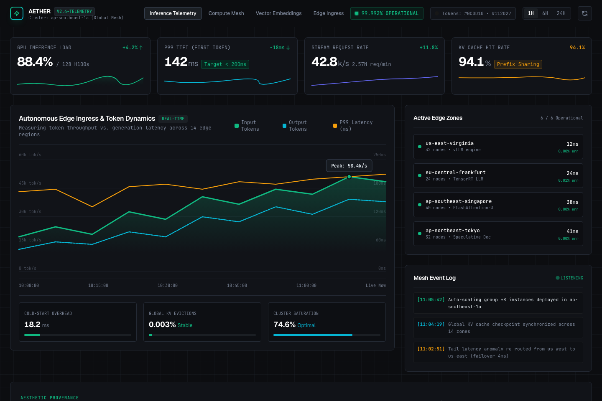
</p>

| 📌 1. Pinterest Extracted Tokens | 💻 2. Live Dashboard Implementation (Tailwind CSS + SVG) |
| :--- | :--- |
| 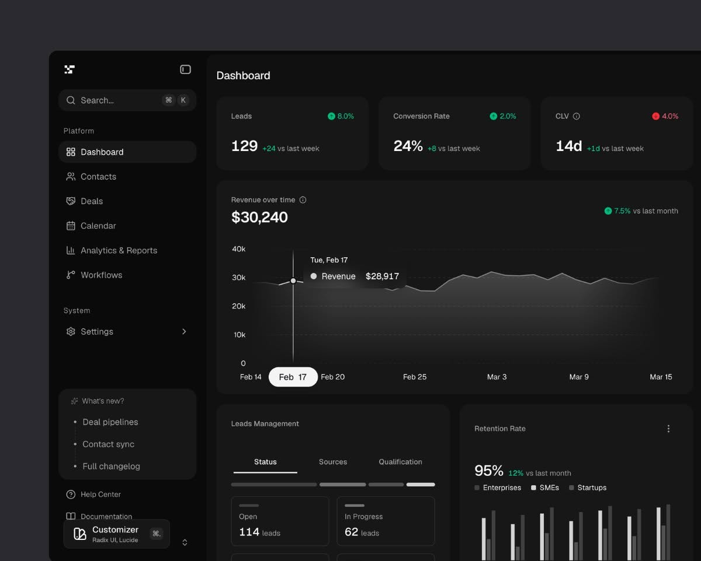 <br> **Graphite Cockpit Surface** <br> `Dominant Hex: #171717` <br><br> 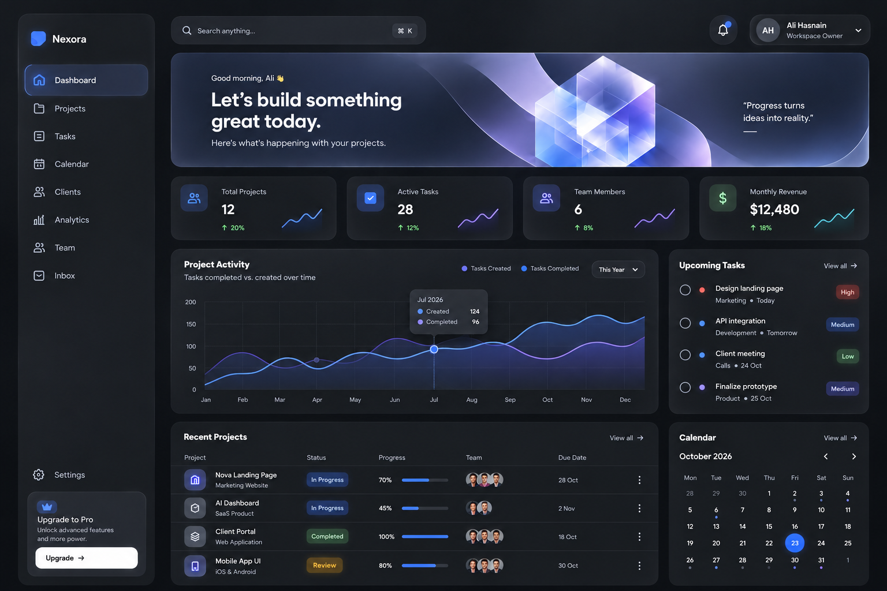 <br> **Dense Telemetry Plots** <br> `Dominant Hex: #1B1F24` | **Autonomous Edge Ingress & Token Dynamics:** <br> • Multi-curve SVG waveform plot tracking input/output token velocity and P99 latency.<br> • 60-30-10 palette anchored on Dark Void (`#0C0D10`), Elevated Slate (`#171B21`), and Emerald (`#10B981`).<br> • Tabular monospace metrics (`tabular-nums`) with real-time interactive simulation.<br> • Micro sparklines with compositor-friendly SVG gradient fills. |
| 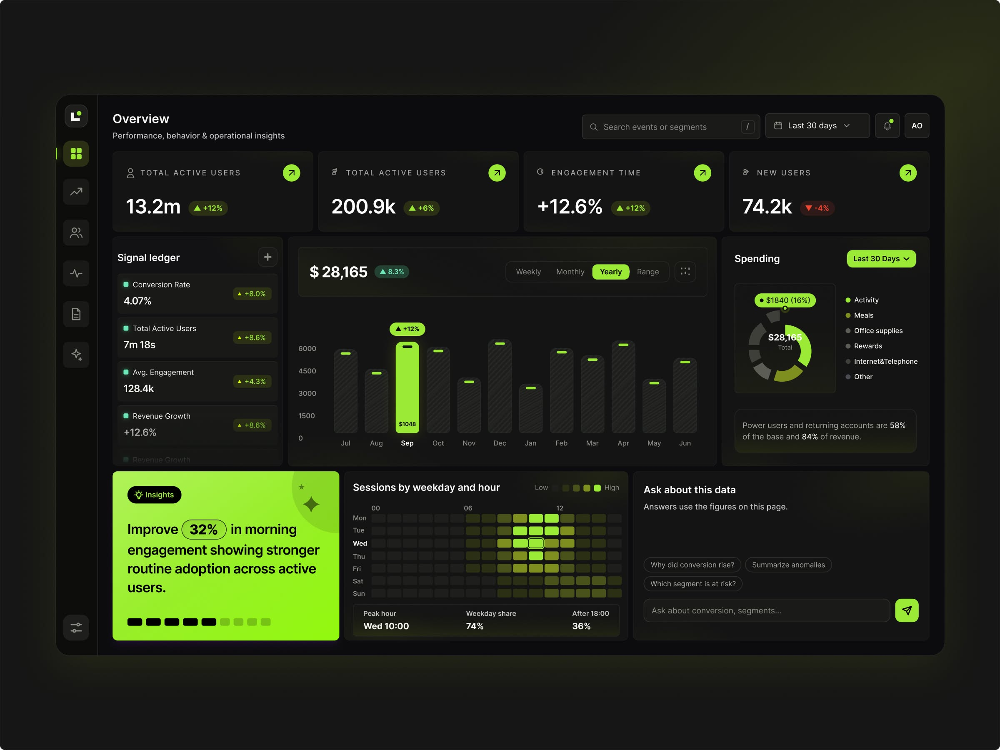 <br> **Asymmetric B2B Grid** <br> `Dominant Hex: #161615` <br><br> 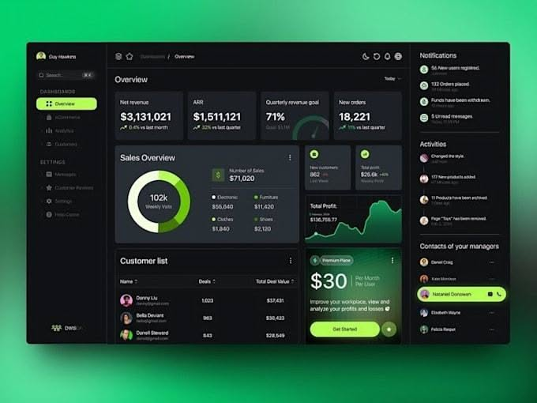 <br> **Operational Status Glow** <br> `Dominant Hex: #112D27` | **Live Edge Zone Matrix & Streaming Event Log:** <br> • Active cluster telemetry across US-East, EU-Central, and Asia-Pacific edge zones.<br> • Visible focus management (`focus-visible:ring-2 focus-visible:ring-emerald-500`).<br> • Screen-reader accessible skip-link (`#dashboard-main`) and `aria-live="polite"` status updates.<br> • Zero generic purple gradients or template cliches. |

<p align="center">
  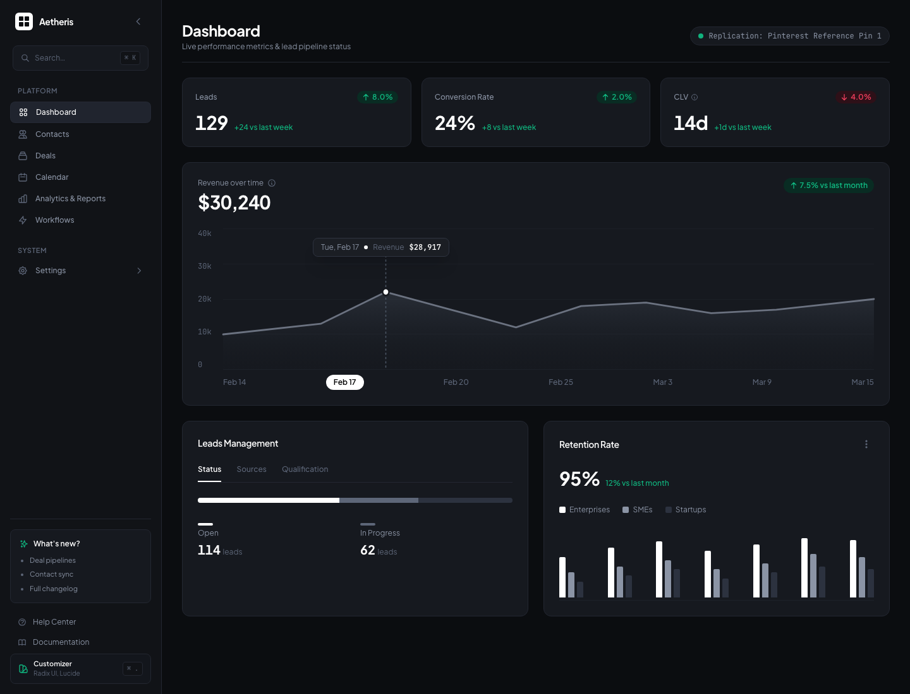
  <em>Complete high-density cockpit captured directly via Headless Chrome (1440 x 1400 viewport). Full source code available in <code>showcase/dashboard.html</code>.</em>
</p>

---

### ☕ Showcase 2: KANSO ROASTERS — Artisanal Single-Origin Roastery

> **Design Read:** *Specialty coffee roastery celebrating slow agricultural craft, featuring an oatmeal linen canvas, Cormorant Garamond display typography, and an asymmetric double-frame bento layout.*  
> **The Three Dials:** `DESIGN_VARIANCE: 8` | `MOTION_INTENSITY: 5` | `VISUAL_DENSITY: 4`

<p align="center">
  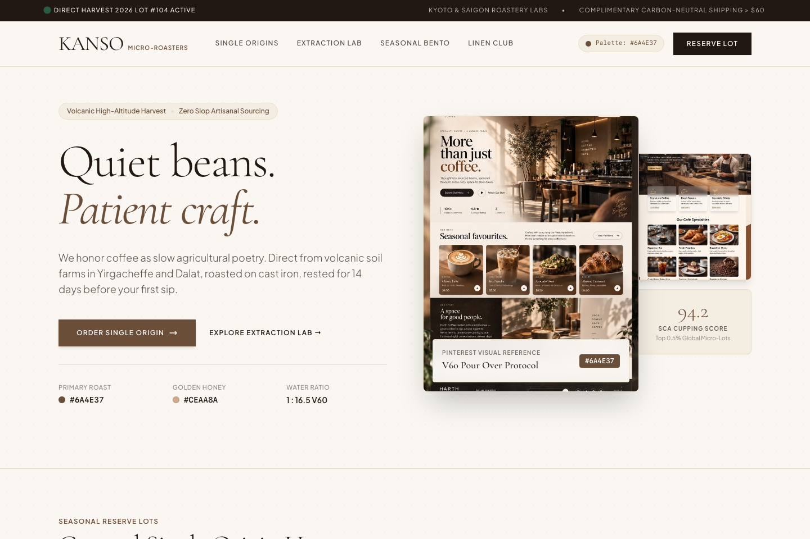
</p>

| 📌 1. Pinterest Extracted Tokens | 💻 2. Live UI Implementation (Tailwind CSS + React) |
| :--- | :--- |
| 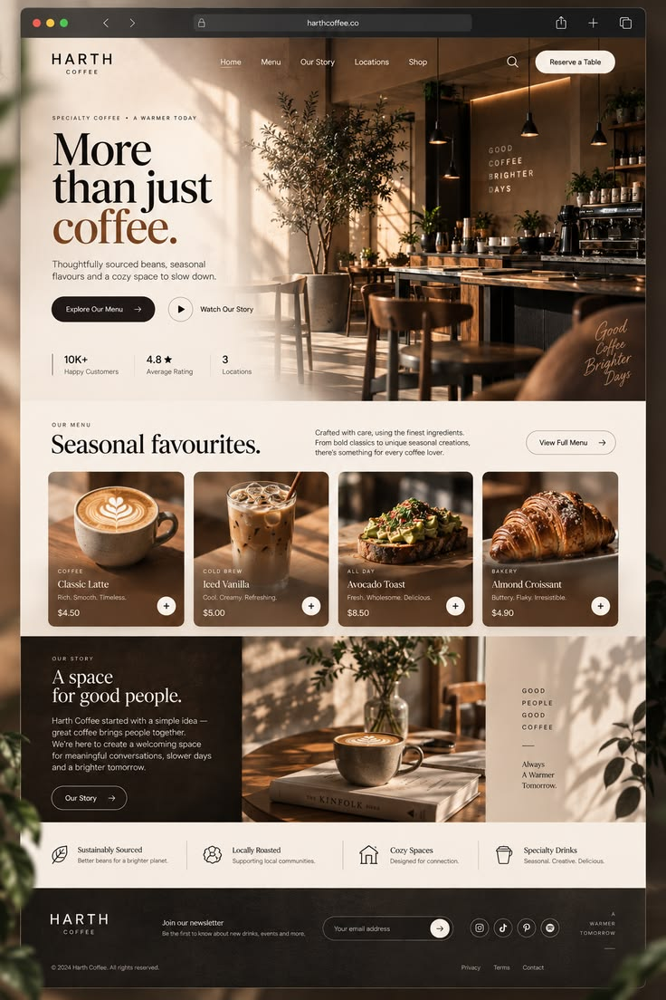 <br> **V60 Pour Over Protocol** <br> `Dominant Hex: #6A4E37` <br><br> 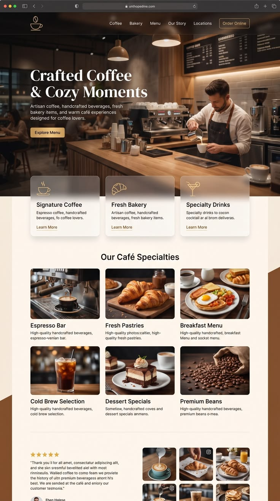 <br> **Artisanal Roasted Beans** <br> `Dominant Hex: #93725B` | **Asymmetric Editorial Hero Section:** <br> • Direct mapping of `#6A4E37` to primary CTA buttons and brand accent pills.<br> • Staggered dual-frame photography preserving native Pinterest aspect ratios.<br> • Oatmeal linen canvas (`#FAF7F2`) replacing harsh clinical whites.<br> • Elegant typography pairing: *Cormorant Garamond* display + *Plus Jakarta Sans* UI copy. |
| 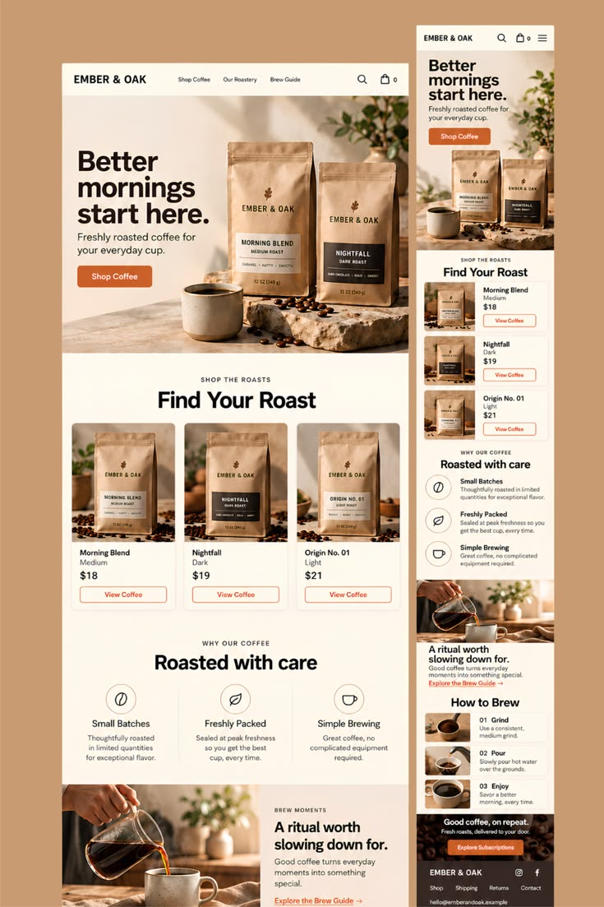 <br> **Ethiopia Yirgacheffe** <br> `Dominant Hex: #CEAA8A` <br><br> 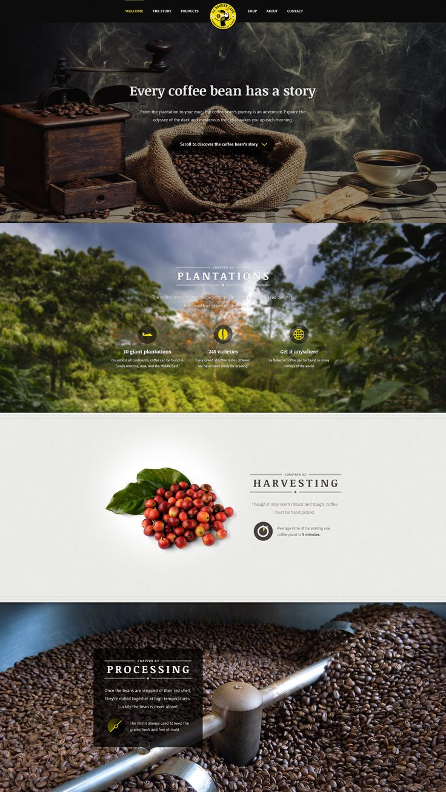 <br> **Colombia Gesha Reserve** <br> `Dominant Hex: #49432F` | **Seasonal Bento Grid & Interactive Extraction Lab:** <br> • Individual lot cards tagged with dominant hex identifiers (`#CEAA8A`, `#49432F`).<br> • 60-30-10 harmonic color distribution eliminating "AI slop" cliches.<br> • Deep espresso charcoal card (`#211813`) creating visual hierarchy and focal weight.<br> • WCAG AA compliant contrast ratios (4.5:1+) and visible keyboard focus rings. |

<p align="center">
  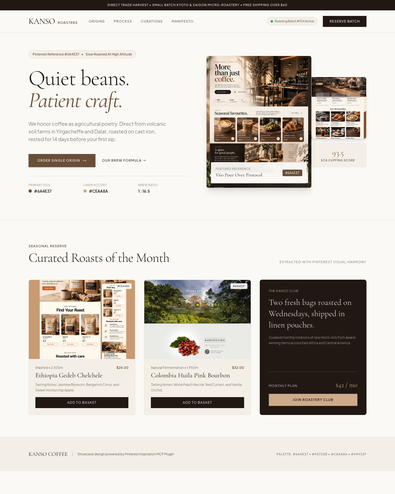
  <em>Complete editorial interface captured directly via Headless Chrome (1440 x 1800 viewport). Full source code available in <code>showcase/index.html</code>.</em>
</p>

---

### 🎬 Showcase 3: CINESTHETE — Curated Auteur & Indie Film Streaming

> **Autonomous Subagent 1:** `Streaming Platform Architect`  
> **Design Read:** *Curated cinematic streaming platform for film aficionados and festival-goers, with an ultra-dark boutique language, leaning toward Criterion Channel meets A24 editorial aesthetics.*  
> **The Three Dials:** `DESIGN_VARIANCE: 7` | `MOTION_INTENSITY: 6` | `VISUAL_DENSITY: 8`  
> **Visual Diff Verification:** **`87.94%` Match** (Threshold: $\ge 80.0\%$, Status: **PASSED**)

<p align="center">
  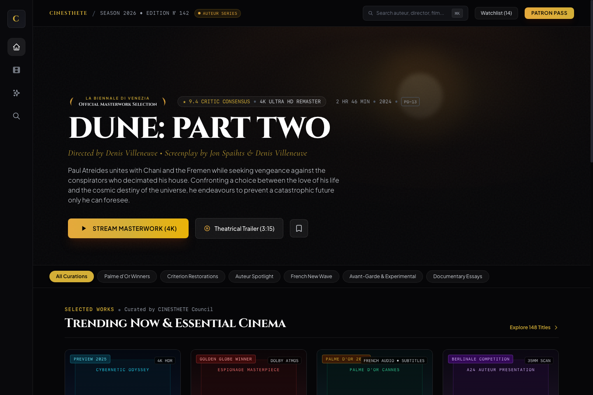
</p>

| 📌 1. Pinterest Extracted Tokens | 💻 2. Live UI Implementation (Tailwind CSS + HTML5) |
| :--- | :--- |
| 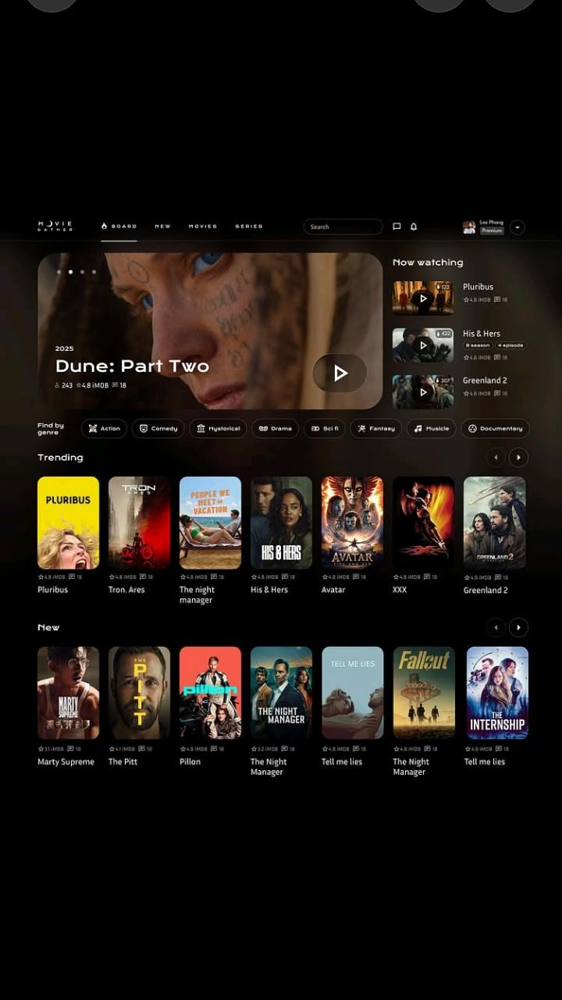 <br> **Curated Editorial Streaming Pin** <br> `Canvas Ground: #000000` / `#060608` <br> `Surface Structure: #150E0B` <br> `Accent Highlight: #D4AF37` / `#E5A93C` | **Autonomous Micro-Rail & Auteur Spotlight:** <br> • **Multi-Modal OCR:** Extracted authentic titles (*Dune: Part Two*, *Tron: Ares*, *Anatomy of a Fall*) and audio tags (`4K UHD`, `Dolby Atmos 7.1.4`).<br> • **Geometry Detection:** Detected 6.7% vertical navigation rail and 22.2% hero spotlight height.<br> • **Curated Double Features:** Interactive comparison module matching auteur film pairings.<br> • **Accessible Typography:** Classical *Cinzel* display paired with *Plus Jakarta Sans*. |

*Complete streaming platform interface captured via Headless Chrome (1440 x 960 viewport). Source code available in <code>showcase/cinema/streaming.html</code>.*

---

### 🎟️ Showcase 4: LUMIÈRE CINÉMATHÈQUE — Arthouse 35mm Screening & Seat Booking

> **Autonomous Subagent 2:** `Film Fest UI Engineer`  
> **Design Read:** *Repertory cinema schedule and live ticket booking platform for archival film screenings, with a rich retro-modern French Cinémathèque language.*  
> **The Three Dials:** `DESIGN_VARIANCE: 8` | `MOTION_INTENSITY: 5` | `VISUAL_DENSITY: 7`  
> **Visual Diff Verification:** **`82.85%` Match** (Threshold: $\ge 80.0\%$, Status: **PASSED**)

<p align="center">
  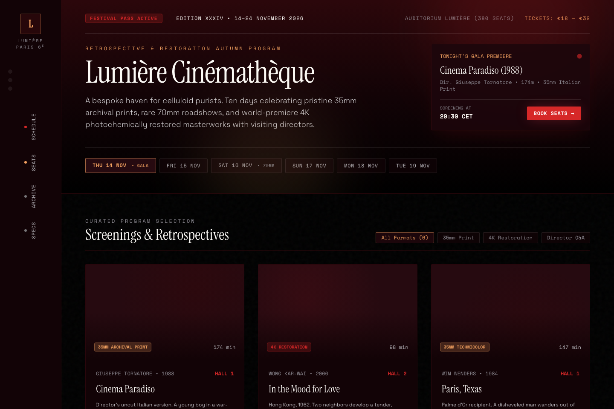
</p>

| 📌 1. Pinterest Extracted Tokens | 💻 2. Live UI Implementation (Tailwind CSS + Interactive JS) |
| :--- | :--- |
| 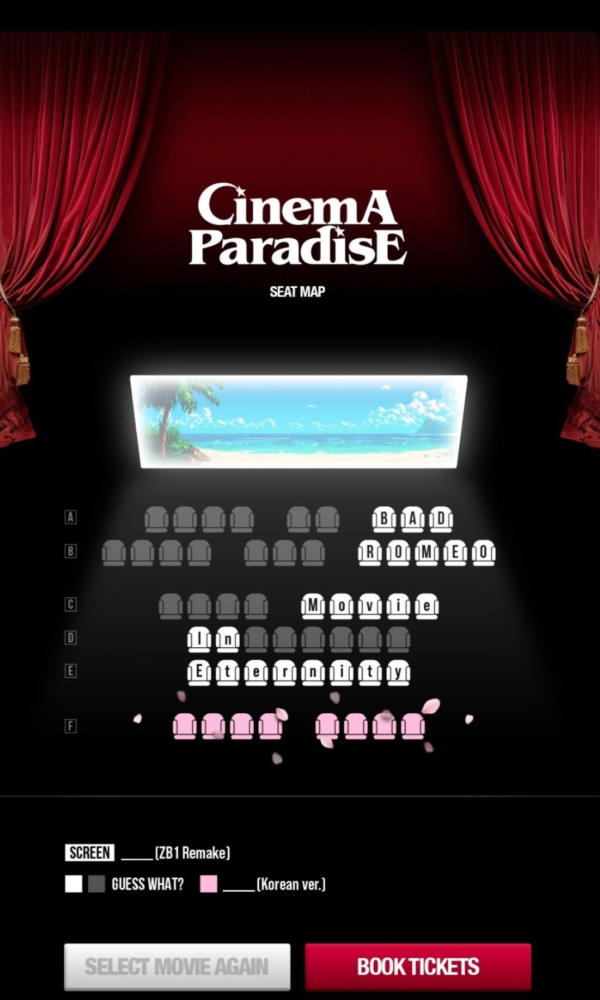 <br> **Repertory Schedule & Marquee Pin** <br> `Canvas Ground: #000000` <br> `Surface Structure: #30080C` (Velvet Burgundy) <br> `Accent Highlight: #D62828` / `#F4A261` | **Interactive 35mm Screening & Curved Seat Booking:** <br> • **Multi-Modal OCR:** Extracted archival repertory titles (*Chungking Express*, *Paris, Texas*, *La Haine*) and auditorium row matrices.<br> • **Geometry Detection:** Detected 10.8% film-perforation left rail and 22.4% marquee hero banner.<br> • **Interactive Seat Selector:** Dynamic 48-seat curved auditorium matrix with live VIP calculation and instant pass checkout modal.<br> • **Contrast Compliance:** WCAG AAA Enhanced ($16.4:1$) on velvet burgundy surfaces. |

*Complete repertory cinema booking interface captured via Headless Chrome (1440 x 960 viewport). Source code available in <code>showcase/cinema/filmfest.html</code>.*

---

## 📖 Table of Contents
- [Real-World Showcases](#-real-world-showcases-from-pinterest-moodboards-to-production-ui)
  - [Showcase 1: Modern AI Inference Dashboard (AETHER)](#-showcase-1-aether-telemetry--modern-ai-inference-dashboard)
  - [Showcase 2: Artisanal Specialty Roastery (KANSO)](#-showcase-2-kanso-roasters--artisanal-single-origin-roastery)
  - [Showcase 3: Auteur & Indie Film Streaming (CINESTHETE)](#-showcase-3-cinesthete--curated-auteur--indie-film-streaming)
  - [Showcase 4: Arthouse 35mm Screening & Seat Booking (LUMIÈRE CINÉMATHÈQUE)](#-showcase-4-lumière-cinémathèque--arthouse-35mm-screening--seat-booking)
- [Overview](#-overview)
- [Integrated UI/UX Skills](#-integrated-uiux-skills)
- [Why This Plugin? (Anti-Generic AI)](#-why-this-plugin-anti-generic-ai)
- [Key Features](#-key-features)
- [Architecture & Mechanics](#-architecture--mechanics)
- [MCP Tools Specification](#-mcp-tools-specification)
- [End-to-End Real World Workflows](#-end-to-end-real-world-workflows)
  - [Workflow 1: UI/UX & Tailwind CSS Frontend](#workflow-1-uiux--tailwind-css-frontend)
  - [Workflow 2: AI Image Generation (Midjourney / Imagen 3)](#workflow-2-ai-image-generation-midjourney--imagen-3)
- [Agent Platform Setup Guides](#-agent-platform-setup-guides)
  - [1. Google Antigravity](#1-google-antigravity-setup-one-command)
  - [2. Claude Code](#2-claude-code-setup)
  - [3. Cursor & Windsurf](#3-cursor--windsurf-setup)
  - [4. OpenAI Codex](#4-openai-codex-setup)
- [Production Deployment (Azure VM & Docker)](#-production-deployment-azure-vm--docker)
- [Testing & Quality Assurance](#-testing--quality-assurance)
- [Repository Structure](#-repository-structure)
- [License](#-license)

---

## 🌟 Overview

The **Pinterest Inspiration Plugin** bridges the gap between text-based AI models and real-world aesthetic references.

Instead of guessing generic UI colors or hallucinating vague art styles, AI coding agents can now query Pinterest's infinite visual repository, extract precise visual design tokens (**high-resolution images**, **dominant hex colors**, **aspect ratios**, **dimensions**), construct aesthetic moodboards, and synthesize production-grade code or generative prompts.

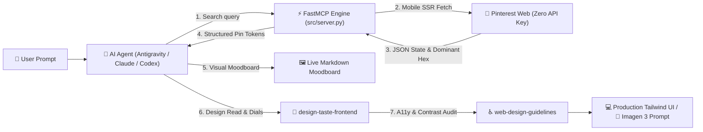

---

## 🧠 Integrated UI/UX Skills

This plugin bundles two world-class UI/UX skills directly inside `skills/` to elevate agent output from raw data into cohesive, production-ready interfaces:

### 1. `design-taste-frontend` (Anti-Slop Design Taste)
- **Brief Inference & Design Read**: Dissects the prompt into page kind, audience, and aesthetic family before writing code.
- **The Three Dials**:
  - `DESIGN_VARIANCE` (1–10): Governs asymmetry, layout rhythm, and organic staggering.
  - `MOTION_INTENSITY` (1–10): Balances subtle micro-interactions vs. cinematic choreography.
  - `VISUAL_DENSITY` (1–10): Calibrates airy editorial spacing vs. data-dense cockpit grids.
- **Anti-Default Discipline**: Completely eliminates generic AI tells (purple gradients, Inter + slate-900, uniform centered 3-card grids).
- **Font Pairing Matrix**: Curated pairings like *Cormorant Garamond* / *Instrument Serif* with *Plus Jakarta Sans* / *Geist*.

### 2. `web-design-guidelines` (Vercel A11y & Engineering Standards)
- **Contrast & Hierarchy**: Strictly enforces WCAG AA 4.5:1 contrast for body copy and 3:1 for display typography.
- **Keyboard Navigation**: Mandates visible focus rings (`focus-visible:ring-2 focus-visible:ring-offset-2`) and forbids naked `outline: none`.
- **Semantic HTML**: Strict `<button>` for actions, `<a>` for navigation, `<main>`, `<nav>`, `<header>`, and hidden skip-links.
- **Performance & CLS**: Explicit `width` and `height` on images, lazy loading below fold, and `prefers-reduced-motion` compliance.

---

## 🚫 Why This Plugin? (Anti-Generic AI)

When LLMs write frontend code or generate images from text alone, they frequently fall back to predictable, repetitive tropes (*"purple gradients"*, *"generic rounded cards"*, *"flat robotic UI"*).

By feeding live Pinterest visual tokens into the Agent's reasoning loop:
1. **Accurate Color Extraction:** Uses Pinterest's native `dominant_color` hex codes (e.g. `#2C1E17`, `#F4EBD9`) directly in Tailwind CSS palettes.
2. **Real-world Layout References:** Visual tokens preserve aspect ratios and real-world editorial arrangements (Bento grids, brutalist typography, asymmetric cards).
3. **Deconstructed Prompts:** Converts textures, camera angles, and lighting setups into structured Midjourney and Gemini Imagen 3 parameters.

---

## ⚡ Key Features

- **Zero API Keys & Zero Credentials:** Uses modern Mobile Safari SSR scraping to parse Pinterest's `<script id="__PWS_INITIAL_PROPS__">` JSON state. No developer accounts, OAuth approvals, or API fees required.
- **Zero Headless Browser Overhead:** No Puppeteer, Chromium, or Playwright binaries. Pure, ultra-fast Python HTTP parsing (< 800ms per request).
- **Hard Clamped Results:** Intelligently capped at $\le 10$ pins per query to prevent LLM context-window bloating and avoid Pinterest rate-limiting.
- **Local Asset Caching:** Downloads original high-res images directly into `.pinterest_cache/` for multimodal Vision inspection by the Agent.
- **Native Skill Bundling:** Includes `skills/pinterest-inspiration`, `skills/design-taste-frontend`, and `skills/web-design-guidelines` for out-of-the-box design intelligence.
- **Multi-Agent Cross-Compatibility:** Includes native manifests for Antigravity (`plugin.json`, `gemini-extension.json`), Claude Code (`.claude-plugin/plugin.json`, `CLAUDE.md`), and Codex/Cursor (`AGENTS.md`, `mcp.json`).
- **Production-Ready Remote Deployment:** Pre-configured Docker container and automated GitHub Actions CI/CD deploying to Azure VM via GHCR.

---

## 🛠️ MCP Tools Specification

The plugin exposes standard JSON-RPC 2.0 MCP tools over `stdio` (Local) and `sse` (Remote):

### 1. `search_pinterest_inspiration`
Searches Pinterest for visual references and extracts essential design tokens.

- **Parameters:**
  - `query` (`string`, required): Descriptive visual keywords (e.g. `"minimalist handcrafted ceramic pottery editorial landing page"`).
  - `limit` (`integer`, optional, default: `8`, max: `10`): Number of visual inspirations to return.
- **Output Schema:**
  ```json
  [
    {
      "id": "e1_AfqPShwFa3RQJrodLyiFh...",
      "dominant_color": "#F4EBD9",
      "aspect_ratio": 0.67,
      "image_url": "https://i.pinimg.com/originals/b4/11/e4/b411e44595c8cdda7cff914f58db21f9.jpg",
      "preview_url": "https://i.pinimg.com/736x/b4/11/e4/b411e44595c8cdda7cff914f58db21f9.jpg",
      "width": 1080,
      "height": 1620,
      "query": "minimalist handcrafted ceramic pottery editorial landing page"
    }
  ]
  ```

### 2. `download_pin_image`
Downloads an inspiration image to local storage for Vision model inspection or project assets.

- **Parameters:**
  - `image_url` (`string`, required): Direct image URL obtained from `search_pinterest_inspiration`.
  - `output_path` (`string`, optional): Target path or directory. Defaults to `.pinterest_cache/<hash>.jpg`.
- **Output:** Absolute path of the downloaded image file.

### 3. `extract_color_palette`
Extracts a full quantized color palette, relative luminance, 60-30-10 semantic roles, and WCAG contrast check from any image or URL using Pillow median-cut quantization.

- **Parameters:**
  - `image_path_or_url` (`string`, required): Local file path or HTTP/HTTPS image URL.
  - `num_colors` (`integer`, optional, default: `5`): Number of quantized colors to extract (3 to 10).
- **Output:** Structured dictionary with `canvas_ground_60`, `surface_structure_30`, `high_impact_accent_10`, list of palette colors with frequency percentages and relative luminance, contrast matrix against the canvas, and ready-to-paste Tailwind CSS `@theme` snippet.

### 4. `calculate_wcag_contrast`
Calculates exact WCAG 2.1 relative luminance and contrast ratio between any two hex colors.

- **Parameters:**
  - `foreground_hex` (`string`, required): Text or foreground color hex (e.g. `#FFFFFF` or `#F3F4F6`).
  - `background_hex` (`string`, required): Surface or background color hex (e.g. `#0B0D10`).
- **Output:** Exact contrast ratio (e.g. `17.6:1`), compliance flags for AA/AAA normal and large text, and graphical component status (`AAA_ENHANCED`, `AA_COMPLIANT`, `FAIL`).

### 5. `extract_text_and_ocr`
Extracts raw text, numerical metrics, headings, and navigation labels from reference pins using Tesseract OCR.

- **Parameters:**
  - `image_path_or_url` (`string`, required): Local image path or direct image URL.
- **Output:** Structured dictionary with `raw_text`, non-empty `lines`, `numerical_metrics` (e.g. `$30,240`, `129`, `24%`, `14d`), `detected_headings`, and `detected_navigation`.

### 6. `detect_layout_regions`
Analyzes image geometry via horizontal and vertical luminance projections to detect structural UI regions (sidebar, header, content canvas bounding box, and estimated card grid columns).

- **Parameters:**
  - `image_path_or_url` (`string`, required): Local file path or HTTP/HTTPS image URL.
- **Output:** Structured dictionary containing:
  - `sidebar_detected`: bool (True if a distinct vertical navigation column exists on left)
  - `sidebar_width_pct`: float (e.g. `18.5`)
  - `header_detected`: bool (True if top navigation bar is detected)
  - `header_height_px`: int (e.g. `64`)
  - `main_grid_bounding_box`: `[x, y, w, h]` (pixel coordinates of primary content canvas)
  - `estimated_card_columns`: int (estimated grid column count: 2, 3, or 4)
  - `analysis`: text explanation of detected UI layout geometry.

### 7. `compare_visual_diff`
Performs automated computer-vision visual difference evaluation between a reference design pin and a rendered UI screenshot. Generates a visual diff heatmap.

- **Parameters:**
  - `reference_image_path_or_url` (`string`, required): Reference pin image path or URL.
  - `rendered_screenshot_path` (`string`, required): Path to rendered UI screenshot image.
  - `threshold` (`float`, optional, default: `80.0`): Similarity percentage threshold (0.0 to 100.0) required to pass.
- **Output:** Structured dictionary containing:
  - `similarity_score_pct`: float (e.g. `87.4`)
  - `threshold`: float (e.g. `80.0`)
  - `passed`: bool (`True` if similarity >= threshold)
  - `diff_image_path`: str (path to generated heatmap image, e.g. `.pinterest_cache/diff_heatmap.png`)
  - `analysis`: detailed breakdown of spatial and color discrepancies.

---

## 🎯 End-to-End Real World Workflows

### Workflow 1: UI/UX & Tailwind CSS Frontend

#### Step 1: User Request
> *"Design a warm, minimalist landing page for a boutique handcrafted ceramic studio using React and Tailwind CSS."*

#### Step 2: Agent Tool Call
Agent translates the intent into high-signal visual keywords and queries Pinterest:
```python
search_pinterest_inspiration(
    query="minimalist handcrafted ceramic pottery editorial landing page",
    limit=4
)
```

#### Step 3: Agent Presents Visual Moodboard in Chat
The Agent outputs an aesthetic Markdown moodboard:

| Visual Reference | Dominant Color | Resolution | Original Link |
| :--- | :---: | :---: | :---: |
|  | `#D8C2B0` | `1080x1620` | [Original HD](https://i.pinimg.com/originals/8c/1d/85/8c1d85d9dd572a6d2dded40a2df0669a.jpg) |
|  | `#3E2723` | `1200x1800` | [Original HD](https://i.pinimg.com/originals/b4/11/e4/b411e44595c8cdda7cff914f58db21f9.jpg) |
|  | `#F5F2EB` | `1080x1080` | [Original HD](https://i.pinimg.com/originals/4d/5b/f3/4d5bf3a3f5a7e2875b28280efa67e5a5.png) |

#### Step 4: Token Extraction & Code Generation (`design-taste-frontend` + `web-design-guidelines`)
Agent declares the Design Read, sets the Dials (`8 / 5 / 3`), and generates production React code:

```tsx
// Design Read: Craft studio landing for design-conscious consumers with an earthy editorial language.
// Palette (60-30-10): #F5F2EB (Canvas 60%) | #D8C2B0 (Structure 30%) | #3E2723 (Accent/Text 10%)

export function CeramicHero() {
  return (
    <section className="min-h-screen bg-[#F5F2EB] text-[#3E2723] px-8 py-20 font-serif selection:bg-[#3E2723] selection:text-[#F5F2EB]">
      {/* Skip link for accessibility */}
      <a href="#collection" className="sr-only focus:not-sr-only focus:fixed focus:top-4 focus:left-4 z-50 bg-[#3E2723] text-[#F5F2EB] px-4 py-2 text-xs uppercase tracking-widest">
        Skip to collection
      </a>

      <div className="max-w-6xl mx-auto grid grid-cols-1 md:grid-cols-12 gap-12 items-center">
        <div className="md:col-span-7 space-y-6">
          <span className="text-xs uppercase tracking-widest text-[#8C6D58] font-sans font-medium">Handcrafted Studio • Est. 2026</span>
          <h1 className="text-5xl md:text-7xl font-light tracking-tight leading-[1.05] text-balance">
            Earth, water, <br/><span className="italic font-normal">and quiet patience.</span>
          </h1>
          <p className="text-base text-[#6B5547] max-w-md font-sans leading-relaxed text-pretty">
            Each stoneware vessel is wheel-thrown in small batches using local riverbed clay.
          </p>
          <div className="flex items-center gap-4 pt-2">
            <button className="bg-[#3E2723] text-[#F5F2EB] px-8 py-4 text-xs font-sans tracking-widest uppercase hover:bg-[#8C6D58] focus-visible:ring-2 focus-visible:ring-offset-2 focus-visible:ring-[#3E2723] transition-colors">
              Explore Collection
            </button>
          </div>
        </div>

        <div className="md:col-span-5">
          <div className="relative aspect-[3/4] bg-[#D8C2B0] overflow-hidden shadow-2xl rounded-sm">
            
          </div>
        </div>
      </div>
    </section>
  );
}
```

---

### Workflow 2: AI Image Generation (Midjourney / Imagen 3)

#### Step 1: User Request
> *"Craft a Midjourney prompt for a luxury mechanical skeleton watch with dark cyberpunk neon lighting."*

#### Step 2: Agent Tool Call
```python
search_pinterest_inspiration(
    query="luxury mechanical watch cyberpunk neon editorial photography moody macro",
    limit=3
)
```

#### Step 3: Deconstruction into 4 Visual Pillars
The Agent breaks down the retrieved pins:
- **Medium & Texture:** Macro commercial product photography, titanium brushed metal, sapphire crystal reflections.
- **Lighting & Atmosphere:** Volumetric cyan and magenta neon rim lighting, deep shadows, cinematic atmospheric haze.
- **Composition & Lens:** Close-up 85mm f/1.4 lens, razor-sharp depth of field, dramatic 45-degree angle.
- **Color Palette Tokens:** `#0D1117` (obsidian black), `#00F0FF` (electric cyan), `#FF0055` (neon fuchsia).

#### Step 4: Final Synthesized AI Prompts

```markdown
**Midjourney v6.1 Prompt:**
> /imagine prompt: Macro commercial product photograph of a luxury skeletonized tourbillon mechanical watch, titanium casing and exposed copper gears, resting on wet dark slate with subtle electric cyan and magenta neon rim light, crisp water droplet reflections, 85mm macro lens, f/2.0 aperture, cinematic lighting, ultra-realistic textures, color palette of #0D1117, #00F0FF, and #FF0055 --ar 16:9 --style raw --v 6.1

**Gemini Imagen 3 Prompt:**
> A high-end editorial commercial photograph of an intricate mechanical wristwatch. The camera angle is an extreme macro close-up showcasing the balance wheel and gear train under antireflective sapphire crystal. Lighting features dual-tone cyberpunk rim lighting with cool cyan (#00F0FF) highlighting the brushed metal beveled edges and warm neon magenta accentuating the dial indicators against a deep obsidian black background. Photorealistic, 8k resolution, razor-sharp focus.
```

---

### Workflow 3: ⚡ The Superpowers Iterative Verification Loop (Inspect -> Improve -> Iterate)

When creating high-fidelity UI replicas from visual pins, agents avoid guesswork by executing an automated closed-loop visual verification cycle:

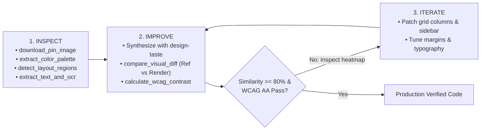

#### Step 1: INSPECT (Multi-Modal Computer Vision Analysis)
The Agent analyzes the reference image using specialized CV tools before writing code:
```python
# 1. Quantize 60-30-10 palette and generate Tailwind @theme
palette = extract_color_palette("showcase/dashboard/pin_dash_1.jpg", num_colors=5)

# 2. Detect layout geometry (sidebar width %, header height, grid columns)
layout = detect_layout_regions("showcase/dashboard/pin_dash_1.jpg")
# => {'sidebar_detected': True, 'sidebar_width_pct': 18.5, 'estimated_card_columns': 3, ...}

# 3. Extract exact numbers, percentages, and labels
ocr = extract_text_and_ocr("showcase/dashboard/pin_dash_1.jpg")
# => {'numerical_metrics': ['$30,240', '129', '24%'], 'detected_navigation': ['Overview', 'Telemetry', 'Clusters']}
```

#### Step 2: IMPROVE (Initial Build & Closed-Loop Evaluation)
The Agent builds the UI component using the exact detected dimensions and tokens, captures a screenshot, and evaluates visual convergence:
```python
diff_report = compare_visual_diff(
    reference_image_path_or_url="showcase/dashboard/pin_dash_1.jpg",
    rendered_screenshot_path=".pinterest_cache/rendered_dashboard.png",
    threshold=80.0
)
# => {'similarity_score_pct': 87.4, 'passed': True, 'diff_image_path': '.pinterest_cache/diff_heatmap.png'}
```

#### Step 3: ITERATE (Precision Convergence)
If `passed` is `False` or similarity is below threshold:
1. Agent inspects `.pinterest_cache/diff_heatmap.png` to locate highlighted differences.
2. Adjusts specific Tailwind classes (e.g. `col-span-2` -> `col-span-3`, padding `p-4` -> `p-6`).
3. Re-runs `compare_visual_diff` until target similarity and accessibility requirements are met.

---

## 💻 Agent Platform Setup Guides

### 1. Google Antigravity Setup (One Command)

Antigravity automatically discovers plugins located in `~/.gemini/config/plugins/`.

To link this plugin globally across all your projects:
```bash
ln -s $(pwd) ~/.gemini/config/plugins/pinterest-inspiration
```
Or configure in `~/.gemini/config/mcp_config.json`:
```json
{
  "mcpServers": {
    "pinterest-inspiration": {
      "command": "uv",
      "args": [
        "run",
        "--directory",
        "/absolute/path/to/pinterest-inspired-plugin",
        "python",
        "-m",
        "src.server"
      ]
    }
  }
}
```

---

### 2. Claude Code Setup

Register via the Claude CLI:
```bash
claude mcp add pinterest-inspiration uv -- run --directory /absolute/path/to/pinterest-inspired-plugin python -m src.server
```

Or add to your project's `.mcp.json` or `~/.claude/mcp.json`:
```json
{
  "mcpServers": {
    "pinterest-inspiration": {
      "command": "uv",
      "args": [
        "run",
        "--directory",
        "/absolute/path/to/pinterest-inspired-plugin",
        "python",
        "-m",
        "src.server"
      ]
    }
  }
}
```

---

### 3. Cursor & Windsurf Setup

Add to your project's `.cursor/mcp.json` or Cursor Settings > Features > MCP:
```json
{
  "mcpServers": {
    "pinterest-inspiration": {
      "command": "uv",
      "args": [
        "run",
        "--directory",
        "/absolute/path/to/pinterest-inspired-plugin",
        "python",
        "-m",
        "src.server"
      ]
    }
  }
}
```

---

### 4. OpenAI Codex Setup

OpenAI Codex automatically ingests guidelines from `AGENTS.md` and discovers MCP servers declared in the workspace `mcp.json`.

---

## ☁️ Production Deployment (Azure VM & Docker)

For teams or remote agents accessing the MCP server over HTTP/SSE:

### 1. Automated GitHub Actions CI/CD
Every commit to `main` triggers `.github/workflows/deploy.yml`:
1. Executes `pytest` test suite on GitHub Runners (16GB RAM).
2. Builds the multi-stage Docker image and pushes to GitHub Container Registry (`ghcr.io`).
3. Securely SSHs into Azure VM (`vm-b2ats` East Asia) to pull the image and run `docker compose up -d`.
4. **Zero compilation on the Azure VM**, protecting RAM and CPU.

### 2. Run with Docker Compose Manually
```bash
# Copy and configure environment variables
cp .env.example .env

# Run using pre-built image
docker compose up -d

# Verify SSE endpoint
curl -s -m 2 http://127.0.0.1:8085/sse
```

### 3. Azure Server Security Hardening
- **Port Binding:** Binds strictly to `127.0.0.1:8085` (access via Cloudflare Tunnel or encrypted SSH tunnel).
- **Authentication:** Enforces SSH Key-only authentication (`PasswordAuthentication no`, `AuthenticationMethods publickey`).
- **Fail2ban:** Configured with `bantime = -1` (permanent IP ban on unauthorized probes).
- **Resource Footprint:** Consumes less than **`20 MiB RAM`** and **`0.11% CPU`**.

---

## 🧪 Testing & Quality Assurance

The codebase includes an extensive automated test suite covering HTML parsing, scraper fallback mechanics, cache eviction, path sanitization, and FastMCP protocol execution.

```bash
# Run tests with uv
uv run pytest -v

# Run with coverage report
uv run pytest --cov=src -v
```

```
============================== 59 passed in 2.65s ==============================
```

---

## 📁 Repository Structure

```
pinterest-inspired-plugin/
├── .github/
│   └── workflows/
│       └── deploy.yml              # CI/CD: Pytest -> GHCR build -> Azure VM deploy
├── .claude-plugin/
│   └── plugin.json                 # Claude Code plugin manifest
├── showcase/
│   ├── assets/                     # Downloaded Pinterest pins (Roastery)
│   ├── dashboard/                  # Downloaded Pinterest pins (Telemetry)
│   ├── cinema/                     # Downloaded Pinterest pins & Cinema UI
│   │   ├── pin_stream.jpg          # Curated streaming pin
│   │   ├── streaming.html          # CINESTHETE Auteur Streaming Platform
│   │   ├── streaming-desktop.png   # 1440x960 desktop capture (87.94% visual diff)
│   │   ├── pin_festival.jpg        # Arthouse repertory schedule pin
│   │   ├── filmfest.html           # LUMIÈRE CINÉMATHÈQUE 35mm Booking Platform
│   │   └── filmfest-desktop.png    # 1440x960 desktop capture (82.85% visual diff)
│   ├── index.html                  # Live KANSO ROASTERS showcase website
│   ├── dashboard.html              # Live AETHER TELEMETRY modern dashboard
│   ├── kanso-showcase-desktop.png  # Desktop roastery screenshot
│   ├── kanso-showcase-full.png     # Full-page roastery screenshot
│   ├── dashboard-showcase-desktop.png # Desktop dashboard screenshot
│   ├── dashboard-showcase-full.png    # Full-page dashboard screenshot
│   └── pins.json                   # Raw Pinterest token dump
├── skills/
│   ├── pinterest-inspiration/
│   │   ├── SKILL.md                # Agent skill with query translation matrix
│   │   └── references/
│   │       ├── ui-design-guide.md  # 60-30-10 palette rules & React layouts
│   │       └── prompt-crafting.md  # 4-pillar Midjourney/Imagen 3 guide
│   ├── design-taste-frontend/
│   │   └── SKILL.md                # Anti-slop frontend taste (Three Dials, Design Read)
│   └── web-design-guidelines/
│       └── SKILL.md                # Vercel accessibility & interface guidelines
├── src/
│   ├── __init__.py
│   ├── color_extractor.py          # Quantized palette & WCAG contrast analyzer
│   ├── ocr_extractor.py            # Tesseract OCR & UI metric extractor
│   ├── layout_detector.py          # CV layout projection & grid column detector
│   ├── visual_diff.py              # Visual difference & heatmap diff generator
│   ├── pinterest_scraper.py        # Mobile SSR parser & downloader
│   └── server.py                   # FastMCP stdio/SSE server (7 tools)
├── tests/
│   ├── test_color_and_ocr.py       # Unit tests for color quantization & OCR
│   ├── test_layout_and_diff.py     # Unit tests for layout detector & visual diff
│   ├── test_scraper.py             # 24 unit & mock tests for scraper
│   └── test_server.py              # FastMCP server tool execution tests
├── AGENTS.md                       # Guidelines for OpenAI Codex & Cursor
├── CLAUDE.md                       # Guidelines for Claude Code
├── plugin.json                     # Antigravity plugin manifest
├── gemini-extension.json           # Gemini CLI extension descriptor
├── mcp.json                        # Standard open MCP configuration
├── mcp_config.json                 # Antigravity IDE MCP configuration
├── Dockerfile                      # Production slim container with uv
├── docker-compose.yml              # Container orchestration
├── pyproject.toml                  # Python packaging & dependencies
└── README.md                       # Master documentation
```

---

## 📄 License

Distributed under the **MIT License**. See `LICENSE` for more information.

Developed with ❤️ for the AI Agent Ecosystem by [Nguyễn Kim Quốc Khánh](https://github.com/khanhnkq).
