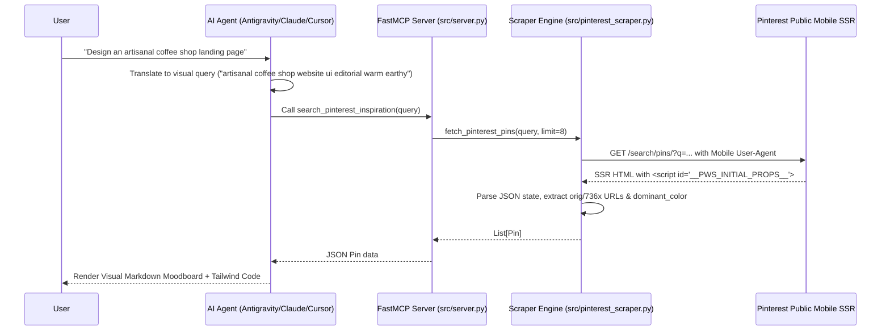

# 🎨 Pinterest Inspiration Plugin

> **Universal Visual Inspiration MCP Plugin & AI Agent Skill**  
> Compatible with **Google Antigravity**, **Claude Code**, **Cursor / Windsurf**, and **OpenAI Codex**.

[](https://modelcontextprotocol.io)
[](https://www.python.org/)
[](LICENSE)

The **Pinterest Inspiration Plugin** equips AI Agents with the ability to search Pinterest for real-world aesthetic references, extract visual design tokens (high-res image URLs, preview thumbnails, dominant color hex values, and aspect ratios), render structured visual moodboards, and apply them directly into downstream frontend code (Tailwind CSS/React) or generative AI prompts (Midjourney/Gemini ImageGen).

---

## ⚡ Key Highlights

- **Zero API Keys & Zero Sign-in**: Scrapes Pinterest's public mobile server-rendered state (SSR) without requiring developer accounts, OAuth, or session cookies.
- **Zero Headless Browser Overhead**: High-speed HTTP execution (< 800ms) with zero Chromium/Puppeteer/Playwright binaries.
- **Rich Visual Design Tokens**: Extracts original high-definition images (`orig`), compressed thumbnails (`736x`), exact Pinterest `dominant_color` hex codes (e.g. `#2C1E17`), and aspect ratios.
- **Local Asset Caching**: Tooling to download reference images into `.pinterest_cache/` for vision model inspection or design assets.
- **Universal Multi-Agent Skill**: Bundles a ready-to-use Agent skill (`skills/pinterest-inspiration`) guiding LLMs to avoid generic AI slop and produce publication-grade UI and prompts.

---

## 🛠️ MCP Tools Reference

The plugin runs as an stdio Model Context Protocol (MCP) server providing two primary tools:

### 1. `search_pinterest_inspiration`
Searches Pinterest for visual pins matching a query and extracts design tokens.

- **Inputs**:
  - `query` (*string*, required): Visual English search keywords (e.g., `"minimalist coffee shop branding editorial"`).
  - `limit` (*integer*, optional, default: `8`, max: `10`): Number of pins to retrieve.
- **Output Sample**:
  ```json
  [
    {
      "id": "1087197091392817452",
      "image_url": "https://i.pinimg.com/originals/ab/cd/ef/abcdef12345.jpg",
      "preview_url": "https://i.pinimg.com/736x/ab/cd/ef/abcdef12345.jpg",
      "dominant_color": "#2C1E17",
      "width": 1080,
      "height": 1920,
      "aspect_ratio": 0.56,
      "query": "minimalist coffee shop branding editorial"
    }
  ]
  ```

### 2. `download_pin_image`
Downloads a pin image to the local project workspace for Vision model inspection or project use.

- **Inputs**:
  - `image_url` (*string*, required): URL of the pin image to download.
  - `output_path` (*string*, optional): Custom target path. Defaults to `.pinterest_cache/<filename>.jpg`.
- **Output**: Local absolute file path of the downloaded image.

---

## 📦 Installation & Setup

### Prerequisites
- Python 3.10+
- [`uv`](https://github.com/astral-sh/uv) (recommended) or `pip`

Clone the repository and install dependencies:
```bash
git clone https://github.com/your-org/pinterest-inspired-plugin.git
cd pinterest-inspired-plugin
uv sync
```

---

### 1. Google Antigravity Setup

Antigravity natively discovers plugins containing `plugin.json`, `gemini-extension.json`, and `mcp_config.json`.

In your Antigravity workspace or global configuration (`~/.gemini/antigravity/mcp_config.json`):
```json
{
  "mcpServers": {
    "pinterest-inspiration": {
      "command": "uv",
      "args": [
        "run",
        "--directory",
        "/absolute/path/to/pinterest-inspired-plugin",
        "src/server.py"
      ]
    }
  }
}
```

The `pinterest-inspiration` skill in `skills/` is automatically discovered by Antigravity's skill engine.

---

### 2. Claude Code Setup

Claude Code supports plugins via `.claude-plugin/plugin.json` or direct MCP CLI registration:

```bash
# Add using the claude CLI
claude mcp add pinterest-inspiration uv -- run --directory /absolute/path/to/pinterest-inspired-plugin src/server.py
```

Alternatively, add to your project's `.mcp.json` or `~/.claude/mcp.json`:
```json
{
  "mcpServers": {
    "pinterest-inspiration": {
      "command": "uv",
      "args": [
        "run",
        "--directory",
        "/absolute/path/to/pinterest-inspired-plugin",
        "src/server.py"
      ]
    }
  }
}
```
Claude Code automatically ingests the behavioral instructions from `CLAUDE.md`.

---

### 3. Cursor & Windsurf Setup

In your project root or user config (`.cursor/mcp.json` or Cursor Settings > MCP):

```json
{
  "mcpServers": {
    "pinterest-inspiration": {
      "command": "uv",
      "args": [
        "run",
        "--directory",
        "/absolute/path/to/pinterest-inspired-plugin",
        "src/server.py"
      ]
    }
  }
}
```

---

### 4. OpenAI Codex Setup

For OpenAI Codex environments, the agent reads instructions directly from `AGENTS.md` and connects to the MCP stdio server via the root `mcp.json`.

---

## 🧠 The Agent Skill & Reference Guides

This plugin bundles a standardized, battle-tested skill located in `skills/pinterest-inspiration/`:

```
skills/pinterest-inspiration/
├── SKILL.md                         # Main Agent skill workflow & moodboard renderer
└── references/
    ├── ui-design-guide.md           # Tailwind CSS tokens, component layouts & typography
    └── prompt-crafting.md           # Midjourney & Gemini ImageGen prompt engineering
```

### The 4-Step Agent Workflow
1. **Query Translation**: Agent translates user requests (including Vietnamese or abstract descriptions) into high-signal visual English queries.
2. **Search & Token Extraction**: Agent calls `search_pinterest_inspiration(query, limit=8)`.
3. **Markdown Moodboard**: Agent presents a visual moodboard with preview images (``) and dominant color hex pills (`#2C1E17`).
4. **Downstream Creation**:
   - **UI Design**: Maps hex values to Tailwind CSS theme tokens (`@theme`) and implements asymmetric bento/hero layouts ([UI Design Guide](skills/pinterest-inspiration/references/ui-design-guide.md)).
   - **AI ImageGen**: Deconstructs pins into Style, Lighting, Composition, and Palette tokens for Midjourney v6+ or Gemini Imagen 3 ([Prompt Crafting Guide](skills/pinterest-inspiration/references/prompt-crafting.md)).

---

## 🧪 Testing & Verification

Run the test suite using `pytest`:

```bash
uv run pytest
```

Test running the MCP server standalone:
```bash
uv run src/server.py
```

---

## 🏗️ Architecture: How It Works



1. **Mobile User-Agent**: Pinterest returns an empty App Shell to unauthenticated desktop clients. Emulating an iPhone Safari User-Agent causes Pinterest's SSR engine to return complete data inside `<script id="__PWS_INITIAL_PROPS__">`.
2. **Visual-First Optimization**: By extracting `orig` (uncompressed original), `736x` (high-res thumbnail), and `dominant_color` hex codes, the Agent receives maximum aesthetic information in minimum context tokens.
3. **Fail-Fast Error Handling**: Network timeouts or rate limits are captured gracefully with actionable fallback advice.

---

## 📄 License

MIT License. See [LICENSE](LICENSE) for details.
