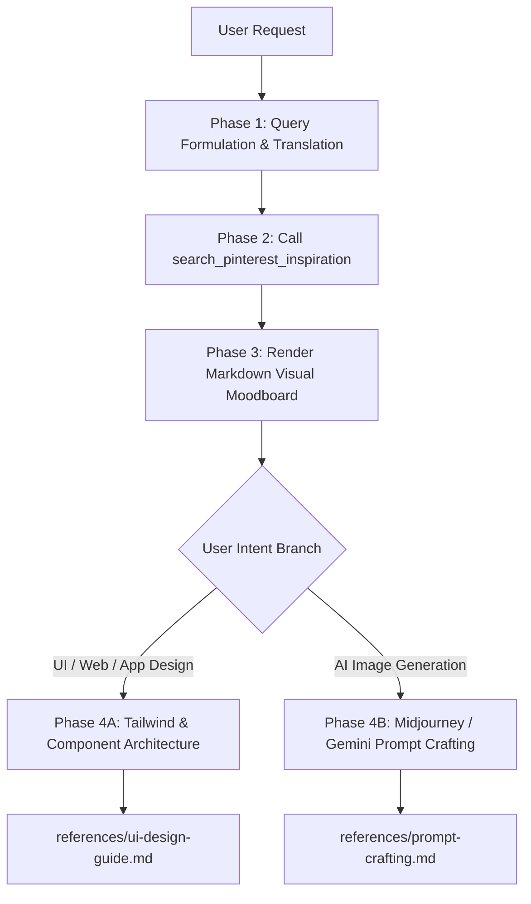

# Pinterest Inspiration Skill

> **Universal AI Agent Skill for Visual Reference & Creative Direction**  
> Compatible with **Google Antigravity, Claude Code, OpenAI Codex, Cursor, and Windsurf**.

This skill empowers AI Agents to search Pinterest for real-world visual references, extract high-fidelity design tokens (HD original images, preview URLs, dominant color hex values, and aspect ratios), render structured visual moodboards, and translate visual concepts directly into production-grade UI/UX code or photorealistic AI image generation prompts.

---

## 1. When to Activate This Skill

Activate this skill whenever the user:
- Requests UI/UX design ideas, landing page concepts, web/mobile dashboards, or app redesigns.
- Asks for color palette recommendations, moodboards, or visual theme inspiration.
- Wants to generate AI images (Midjourney, Gemini ImageGen, Imagen 3, DALL-E) and needs authentic style reference tokens (lighting, texture, angle, composition).
- Provides vague or abstract visual requests (e.g., *"làm giao diện quán cafe tối giản ấm cúng"*, *"design a sleek cybernetic watch landing page"*, *"retro Japanese poster design"*).
- Needs to break free from generic "AI slop" (overused purple-cyan gradients, generic Inter typography, cookie-cutter cards).

---

## 2. Core MCP Tools

The plugin provides two core Model Context Protocol (MCP) tools via stdio:

### 1. `search_pinterest_inspiration`
- **Purpose**: Scrapes top Pinterest pins directly using mobile SSR without requiring Pinterest API credentials.
- **Parameters**:
  - `query` (*string*, required): Visual search query in English.
  - `limit` (*integer*, optional, default: `8`, max: `10`): Number of visual pins to retrieve.
- **Returns**: Array of pin objects:
  ```json
  [
    {
      "id": "1087197091392817452",
      "image_url": "https://i.pinimg.com/originals/...jpg",
      "preview_url": "https://i.pinimg.com/736x/...jpg",
      "dominant_color": "#2c3e50",
      "width": 1080,
      "height": 1920,
      "aspect_ratio": 0.56,
      "query": "minimalist editorial web design"
    }
  ]
  ```

### 2. `download_pin_image`
- **Purpose**: Downloads a selected pin image to local disk for multimodal inspection (Vision models) or inclusion in project assets.
- **Parameters**:
  - `image_url` (*string*, required): Direct URL to the pin image (`image_url` or `preview_url`).
  - `output_path` (*string*, optional): Custom file path or directory. Defaults to `.pinterest_cache/<hash>.jpg`.
- **Returns**: String path of the saved file.

---

## 3. Step-by-Step Agent Workflow



### Phase 1: Query Formulation & Translation

Pinterest search algorithms respond best to **descriptive visual English keywords** rather than abstract conceptual Vietnamese or conversational phrases.

#### Translation & Keyword Expansion Rules:
1. **Always translate non-English requests into English.**
2. **Combine 3–5 high-signal descriptors:**
   - `[Subject/Medium]` + `[Aesthetic Style]` + `[Color/Lighting]` + `[Context/Format]`
3. **Keyword Expansion Matrix:**

| User Prompt | Ineffective Query | Optimal Visual Query |
| :--- | :--- | :--- |
| "Thiết kế app quản lý chi tiêu hiện đại" | `app quan ly chi tieu` | `fintech mobile app ui minimalist clean dark mode` |
| "Landing page quán cafe ấm cúng tối giản" | `coffee website` | `artisanal coffee shop website ui editorial warm earthy` |
| "Poster phong cách Cyberpunk neon" | `cyberpunk poster` | `cyberpunk graphic design typography poster neon chiaroscuro` |
| "Sofa bọc nỉ sang trọng phòng khách" | `luxury sofa living room` | `scandinavian modern living room boucle sofa soft natural lighting` |
| "Giao diện SaaS AI B2B chuyên nghiệp" | `ai b2b dashboard` | `enterprise b2b saas dashboard dense typography sleek slate` |

---

### Phase 2: Call `search_pinterest_inspiration`

Invoke the tool with the formulated query and set `limit` between 6 and 10:

```json
{
  "query": "artisanal coffee shop website ui editorial warm earthy",
  "limit": 8
}
```

*Note: If the search query returns zero pins (rare, but can happen for obscure terms), broaden the query (e.g., remove niche modifiers) and retry once.*

---

### Phase 3: Render the Markdown Visual Moodboard

Always present the findings to the user as a **structured, highly visual Markdown Moodboard** before jumping into code or prompt generation.

#### Required Moodboard Elements:
1. **Curated Color Palette Bar**: Group unique `dominant_color` hex codes from the pins, display them with visual pills, and assign semantic roles.
2. **Visual Inspiration Grid**: Display markdown preview images using `preview_url` (or `image_url`), accompanied by dominant color pills, dimensions, and the aesthetic insight it provides.
3. **Design Synthesis**: A 2–3 bullet summary of the common aesthetic patterns observed (e.g., typography trends, whitespace, lighting, contrast).

#### Standard Moodboard Format:

````markdown
### 🎨 Visual Inspiration Moodboard: [Search Topic]

**Search Query:** `artisanal coffee shop website ui editorial warm earthy`  
**Identified Palette:**
- `Primary`: `#2C1E17` (Dark Roasted Bean)
- `Secondary`: `#8C6546` (Warm Caramel Ochre)
- `Surface/Background`: `#F4EFEA` (Oatmeal Cream)
- `Accent`: `#C15C3D` (Terracotta Clay)
- `Muted Neutral`: `#D8CEBA` (Linen Sand)

---

#### Curated Reference Pins

| Preview | Details & Dominant Tone | Aesthetic Key Takeaways |
| :---: | :--- | :--- |
|  | **Dominant:** `#F4EFEA`<br>**Aspect:** 3:4 (Portrait)<br>**ID:** `108719709139` | High-contrast serif headlines, asymmetric editorial layout, generous negative space. |
|  | **Dominant:** `#2C1E17`<br>**Aspect:** 1:1 (Square)<br>**ID:** `98421839210` | Tactile organic paper texture, gold foil accents, Swiss grid typography. |
|  | **Dominant:** `#8C6546`<br>**Aspect:** 16:9 (Landscape)<br>**ID:** `7421893012` | Soft morning directional light, warm wood grain, muted earth tones. |

---

### 💡 Aesthetic Synthesis
1. **Typography**: High contrast between elegant serif display headings (e.g., *Playfair Display* or *Editorial New*) and clean geometric sans body.
2. **Layout Rhythm**: Asymmetrical, magazine-style layouts with organic margins rather than rigid 3-column cards.
3. **Color Atmosphere**: Warm off-white canvas with deep charcoal/brown text replacing harsh pure `#000000` blacks.
````

---

### Phase 4: Downstream Execution

Once the moodboard is established, branch into one of two paths based on the user's objective:

#### Branch A: UI / UX Design & Frontend Code
Refer to [UI Design Guide](references/ui-design-guide.md) for detailed execution:
1. **Tailwind CSS Theme Tokenization**: Map dominant hexes into CSS variables or Tailwind `@theme` config.
2. **Component Architecture**: Build hero sections, bento grids, navigation, and cards matching the visual rhythm of the pins.
3. **Typography & Styling**: Apply matching font pairings, subtle border gradients, and elevation.

#### Branch B: AI Image Generation Prompting
Refer to [Prompt Crafting Guide](references/prompt-crafting.md) for detailed execution:
1. **Visual Token Extraction**: Deconstruct pins into 4 pillars (Style & Medium, Lighting & Atmosphere, Composition & Framing, Color Palette & Mood Tokens).
2. **Prompt Synthesis**: Generate ready-to-run prompts tailored for Midjourney v6+ or Gemini Imagen 3.
3. **Anti-slop Guardrails**: Eliminate generic stock aesthetics and unnatural plastic lighting.

---

## 4. Anti-Patterns & Best Practices

| Do's ✅ | Don'ts ❌ |
| :--- | :--- |
| **Translate queries into descriptive English** with art & design terminology. | **Don't search in raw conversational Vietnamese** or single vague words like `"web"`. |
| **Display markdown image previews** (``) so the user can see the inspiration. | **Don't just output raw JSON text** or long lists of plain URLs without image embeds. |
| **Extract dominant colors** and assign them to semantic design roles (Background, Text, Accent). | **Don't ignore the colors** or default back to standard Tailwind `purple-600` / `blue-500`. |
| **Limit scraping to 6–10 pins** for focused, high-speed aesthetic extraction. | **Don't request 50+ pins** or overwhelm the LLM context window. |
| **Use `download_pin_image`** when local image inspection or Vision analysis is needed. | **Don't download every image indiscriminately** when visual URLs suffice for prompt/code generation. |

---

## 5. Cross-Agent Environment Support

This skill operates uniformly across all supported environments:
- **Google Antigravity**: Discovered under `skills/pinterest-inspiration/SKILL.md` with tool calls via `mcp_config.json`.
- **Claude Code**: Managed via `.claude-plugin/plugin.json` and `CLAUDE.md`.
- **OpenAI Codex**: Referenced in `AGENTS.md` and standard MCP registry.
- **Cursor / Windsurf**: Configured through `.cursor/mcp.json` or global `mcp.json`.
