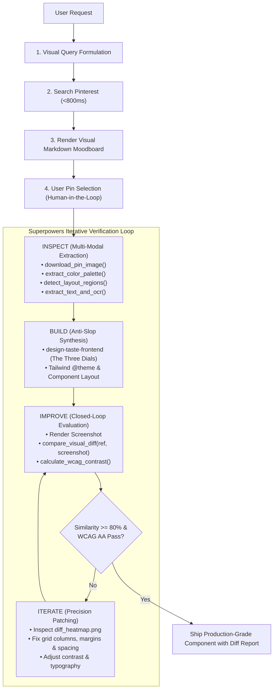

# Pinterest Inspiration Skill

> **Universal AI Agent Skill for Visual Reference, Computer Vision Layout Extraction & Iterative Verification**  
> Integrated with **design-taste-frontend** (Anti-Slop Design Taste) and **web-design-guidelines** (A11y Standards).  
> Compatible with **Google Antigravity, Claude Code, OpenAI Codex, Cursor, and Windsurf**.

This skill empowers AI Agents to search Pinterest for real-world visual references, extract high-fidelity design tokens (HD original images, preview URLs, dominant color hex values, and aspect ratios), perform automated computer-vision layout detection, execute closed-loop visual difference verification, and translate visual concepts directly into production-grade UI/UX code or photorealistic AI image generation prompts.

---

## 1. When to Activate This Skill

Activate this skill whenever the user:
- Requests UI/UX design ideas, landing page concepts, web/mobile dashboards, or app redesigns.
- Asks for color palette recommendations, moodboards, or visual theme inspiration.
- Wants to generate AI images (Midjourney, Gemini ImageGen, Imagen 3, DALL-E) and needs authentic style reference tokens (lighting, texture, angle, composition).
- Asks to replicate or clone an existing design reference with high fidelity.
- Needs to perform visual quality assurance, layout geometry detection, or visual diff comparisons against a reference image.
- Needs to break free from generic "AI slop" (overused purple-cyan gradients, generic Inter typography, cookie-cutter cards).

---

## 2. Core MCP Tools (7 Standardized Tools)

The plugin provides 7 core Model Context Protocol (MCP) tools via stdio / SSE:

### 1. `search_pinterest_inspiration(query: str, limit: int = 8)`
- **Purpose**: Scrapes top Pinterest pins directly using mobile SSR without requiring Pinterest API credentials.
- **Parameters**:
  - `query` (*string*, required): Visual search query in English.
  - `limit` (*integer*, optional, default: `8`, max: `10`): Number of visual pins to retrieve.
- **Returns**: Array of pin objects (`id`, `image_url`, `preview_url`, `dominant_color`, `width`, `height`, `aspect_ratio`, `query`).

### 2. `download_pin_image(image_url: str, output_path: str = '')`
- **Purpose**: Downloads a selected pin image to local disk (`.pinterest_cache/<hash>.jpg`) for multi-modal inspection, layout detection, or inclusion in project assets.
- **Parameters**:
  - `image_url` (*string*, required): Direct URL to the pin image (`image_url` or `preview_url`).
  - `output_path` (*string*, optional): Custom file path or directory.
- **Returns**: Absolute file path of the saved image.

### 3. `extract_color_palette(image_path_or_url: str, num_colors: int = 5)`
- **Purpose**: Quantizes an image into its prominent color palette using Pillow median-cut quantization, relative luminance, 60-30-10 semantic roles, and WCAG contrast check.
- **Parameters**:
  - `image_path_or_url` (*string*, required): Local image path or HTTP URL.
  - `num_colors` (*integer*, optional, default: `5`): Number of quantized colors (3 to 10).
- **Returns**: Dict with `canvas_ground_60`, `surface_structure_30`, `high_impact_accent_10`, list of palette colors with frequency percentages and relative luminance, contrast matrix, and ready-to-paste Tailwind CSS `@theme` snippet.

### 4. `calculate_wcag_contrast(foreground_hex: str, background_hex: str)`
- **Purpose**: Calculates exact WCAG 2.1 relative luminance and contrast ratio between any two hex colors.
- **Parameters**:
  - `foreground_hex` (*string*, required): Foreground/text hex color.
  - `background_hex` (*string*, required): Background/surface hex color.
- **Returns**: Contrast ratio (e.g. `17.6:1`) and WCAG AA/AAA compliance flags (`AAA_ENHANCED`, `AA_COMPLIANT`, `FAIL`).

### 5. `extract_text_and_ocr(image_path_or_url: str)`
- **Purpose**: Runs Tesseract OCR on a reference pin to extract raw text, numerical metrics (`$30,240`, `129`, `24%`), headings, and navigation labels for high-fidelity UI cloning.
- **Parameters**:
  - `image_path_or_url` (*string*, required): Local image path or direct image URL.
- **Returns**: Dict with `raw_text`, `lines`, `numerical_metrics`, `detected_headings`, and `detected_navigation`.

### 6. `detect_layout_regions(image_path_or_url: str)`
- **Purpose**: Analyzes image geometry via horizontal and vertical luminance projections to detect structural UI regions (sidebar, header, content bounding box, and card grid columns).
- **Parameters**:
  - `image_path_or_url` (*string*, required): Local image file path or HTTP image URL.
- **Returns**: Dict containing:
  - `sidebar_detected`: bool (True if a distinct vertical navigation column exists on left)
  - `sidebar_width_pct`: float (e.g. `18.5`)
  - `header_detected`: bool (True if top navigation bar is detected)
  - `header_height_px`: int (estimated height in pixels, e.g. `64`)
  - `main_grid_bounding_box`: `[x, y, w, h]` (pixel coordinates of primary content canvas)
  - `estimated_card_columns`: int (estimated grid column count: 2, 3, or 4)
  - `analysis`: text explanation of detected UI geometry.

### 7. `compare_visual_diff(reference_image_path_or_url: str, rendered_screenshot_path: str, threshold: float = 80.0)`
- **Purpose**: Performs automated computer-vision visual difference evaluation between a reference design pin and a rendered UI screenshot. Generates a visual diff heatmap.
- **Parameters**:
  - `reference_image_path_or_url` (*string*, required): Reference pin image path or URL.
  - `rendered_screenshot_path` (*string*, required): Path to rendered UI screenshot image.
  - `threshold` (*float*, optional, default: `80.0`): Similarity percentage threshold (0.0 to 100.0) required to pass.
- **Returns**: Dict containing:
  - `similarity_score_pct`: float (e.g. `87.4`)
  - `threshold`: float (e.g. `80.0`)
  - `passed`: bool (`True` if similarity >= threshold)
  - `diff_image_path`: str (path to generated heatmap image, e.g. `.pinterest_cache/diff_heatmap.png`)
  - `analysis`: detailed breakdown of spatial and color discrepancies.

---

## 3. Superpowers Iterative Verification Loop (Inspect -> Improve -> Iterate)

To achieve human-designer quality, the agent follows a closed-loop engineering cycle:



### Step 1: INSPECT (Multi-Modal Feature Extraction)
Once the user selects a target reference pin, download it and run automated inspection:
1. `download_pin_image(chosen_pin.image_url)`: Save to `.pinterest_cache/`.
2. `extract_color_palette()`:
   - Identify `canvas_ground_60`, `surface_structure_30`, and `high_impact_accent_10`.
   - Extract ready-to-paste Tailwind CSS `@theme` variables.
3. `detect_layout_regions()`:
   - Determine whether a sidebar exists and its width percentage (`sidebar_width_pct`).
   - Read header height (`header_height_px`) and column count (`estimated_card_columns`).
4. `extract_text_and_ocr()`:
   - Extract exact financial metrics, percentages, heading strings, and tab navigation labels.

### Step 2: BUILD & IMPROVE (Anti-Slop Synthesis & Visual Diffing)
1. Apply **`design-taste-frontend`**:
   - Output the one-line Design Read: `"Reading this as: <kind> for <audience>, with a <vibe> language, leaning toward <aesthetic family>."`
   - Set the Three Dials (`DESIGN_VARIANCE: 7`, `MOTION_INTENSITY: 4`, `VISUAL_DENSITY: 8`).
   - Implement the component using detected tokens (e.g. sidebar width `w-[18.5%]`, grid layout `grid-cols-3`).
2. Verify accessibility with **`calculate_wcag_contrast`**:
   - Ensure all text-to-surface contrast ratios exceed 4.5:1 (WCAG AA).
3. Evaluate visual similarity with **`compare_visual_diff`**:
   - Compare the rendered screenshot against the reference pin:
     `compare_visual_diff(reference_image_path, screenshot_path, threshold=80.0)`

### Step 3: ITERATE (Closed-Loop Convergence)
If `compare_visual_diff` reports `passed: false`:
1. Check `analysis` and examine `.pinterest_cache/diff_heatmap.png`.
2. Pinpoint the source of discrepancy:
   - *Layout mismatch:* Adjust column grid (`grid-cols-2` vs `grid-cols-3`) or sidebar width.
   - *Color divergence:* Align Tailwind background classes with `canvas_ground_60`.
   - *Typography spacing:* Tighten heading leading or card padding.
3. Re-run `compare_visual_diff` until score >= 80% and WCAG AA is verified.

---

## 4. Query Formulation & Translation

Pinterest search algorithms respond best to **descriptive visual English keywords** rather than abstract conceptual or conversational phrases.

### Translation & Keyword Expansion Rules:
1. **Always translate non-English requests into English.**
2. **Combine 3–5 high-signal descriptors:**
   - `[Subject/Medium]` + `[Aesthetic Style]` + `[Color/Lighting]` + `[Context/Format]`
3. **Keyword Expansion Matrix:**

| User Prompt | Ineffective Query | Optimal Visual Query |
| :--- | :--- | :--- |
| "Fintech app dashboard" | `finance app` | `fintech mobile app ui minimalist clean dark mode dense` |
| "Landing page for coffee roaster" | `coffee website` | `artisanal coffee shop website ui editorial warm earthy` |
| "Cyberpunk watch concept" | `cyberpunk watch` | `luxury mechanical watch cyberpunk neon editorial photography` |
| "Ceramic studio portfolio" | `pottery site` | `minimalist handcrafted ceramic pottery editorial landing page` |
| "B2B AI Platform" | `ai software` | `enterprise b2b saas dashboard dense typography sleek slate` |

---

## 5. Visual Moodboard Presentation

Always present search results as a **structured, highly visual Markdown Moodboard** with preview images and dominant color hex pills:

```markdown
### 🎨 Visual Inspiration Moodboard: [Topic]

**Search Query:** `artisanal coffee shop website ui editorial warm earthy`  
**Identified Color Palette:**
- `Primary Accent`: `#6A4E37` (Dark Roasted Bean)
- `Secondary Tone`: `#93725B` (Warm Caramel)
- `Surface Base`: `#CEAA8A` (Almond Ochre)
- `Deep Contrast`: `#49432F` (Olive Charcoal)

---

#### Curated Reference Pins

| Visual Reference | Dominant Tone | Ratio & Dimensions | Aesthetic Takeaway |
| :---: | :---: | :---: | :--- |
|  | `#6A4E37` | 3:4 (Portrait) | High-contrast serif headlines, asymmetric framing |
|  | `#93725B` | 1:1 (Square) | Tactile texture, warm neutral backdrop, clean label |
|  | `#CEAA8A` | 16:9 (Landscape) | Directional morning sunlight, brutalist spacing |

---

### 💡 Aesthetic Synthesis
1. **Typographic Tension**: Contrast between editorial serif titles and monospaced technical labels.
2. **Asymmetric Bento Layout**: Non-uniform card proportions reflecting natural editorial storytelling.
3. **Color Harmony**: 60-30-10 palette anchored on natural roasted tones against an oatmeal background.
```

---

## 6. Anti-Patterns & Best Practices

| Do's ✅ | Don'ts ❌ |
| :--- | :--- |
| **Translate queries into descriptive English** with art & design terminology. | **Don't search in raw conversational non-English** or single vague words like `"web"`. |
| **Display markdown image previews** (``) so the user can see inspiration. | **Don't just output raw JSON text** or long lists of plain URLs without image embeds. |
| **Extract layout regions & exact OCR metrics** before writing UI code. | **Don't guess card columns or invent fake placeholder data** when OCR can extract real metrics. |
| **Run `compare_visual_diff`** to verify visual convergence against the reference. | **Don't assume your first draft looks like the pin** without running visual diff inspection. |
| **Enforce WCAG 4.5:1 contrast** using `calculate_wcag_contrast`. | **Don't use low-contrast muted gray text** that fails accessibility standards. |

---

## 7. Cross-Agent Environment Support

This skill operates uniformly across all supported environments:
- **Google Antigravity**: Discovered under `skills/pinterest-inspiration/SKILL.md` with tool calls via `mcp_config.json`.
- **Claude Code**: Managed via `.claude-plugin/plugin.json` and `CLAUDE.md`.
- **OpenAI Codex**: Referenced in `AGENTS.md` and standard MCP registry.
- **Cursor / Windsurf**: Configured through `.cursor/mcp.json` or global `mcp.json`.
