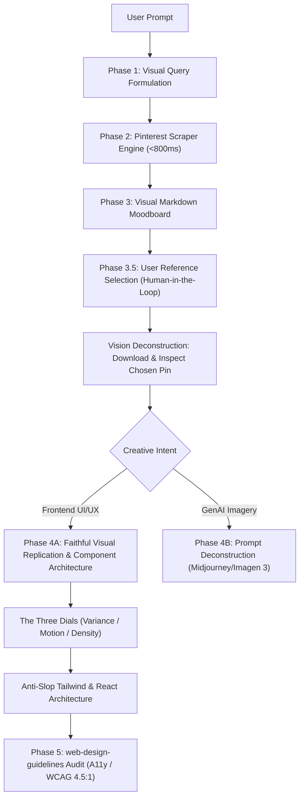

# Pinterest Inspiration Skill

> **Universal AI Agent Skill for Visual Reference & Creative Direction**  
> Integrated with **design-taste-frontend** (Anti-Slop Design Taste) and **web-design-guidelines** (A11y Standards).  
> Compatible with **Google Antigravity, Claude Code, OpenAI Codex, Cursor, and Windsurf**.

This skill empowers AI Agents to search Pinterest for real-world visual references, extract high-fidelity design tokens (HD original images, preview URLs, dominant color hex values, and aspect ratios), render structured visual moodboards, and translate visual concepts directly into production-grade UI/UX code or photorealistic AI image generation prompts.

---

## 1. When to Activate This Skill

Activate this skill whenever the user:
- Requests UI/UX design ideas, landing page concepts, web/mobile dashboards, or app redesigns.
- Asks for color palette recommendations, moodboards, or visual theme inspiration.
- Wants to generate AI images (Midjourney, Gemini ImageGen, Imagen 3, DALL-E) and needs authentic style reference tokens (lighting, texture, angle, composition).
- Provides visual requests that need elevated design execution (e.g., *"design a minimalist artisanal coffee landing page"*, *"design a sleek cybernetic watch dashboard"*, *"retro Japanese poster design"*).
- Needs to break free from generic "AI slop" (overused purple-cyan gradients, generic Inter typography, cookie-cutter cards).

---

## 2. Core MCP Tools

The plugin provides two core Model Context Protocol (MCP) tools via stdio / SSE:

### 1. `search_pinterest_inspiration`
- **Purpose**: Scrapes top Pinterest pins directly using mobile SSR without requiring Pinterest API credentials.
- **Parameters**:
  - `query` (*string*, required): Visual search query in English.
  - `limit` (*integer*, optional, default: `8`, max: `10`): Number of visual pins to retrieve.
- **Returns**: Array of pin objects:
  ```json
  [
    {
      "id": "1087197091392817452",
      "image_url": "https://i.pinimg.com/originals/...jpg",
      "preview_url": "https://i.pinimg.com/736x/...jpg",
      "dominant_color": "#2c3e50",
      "width": 1080,
      "height": 1920,
      "aspect_ratio": 0.56,
      "query": "minimalist editorial web design"
    }
  ]
  ```

### 2. `download_pin_image`
- **Purpose**: Downloads a selected pin image to local disk for multimodal inspection (Vision models) or inclusion in project assets.
- **Parameters**:
  - `image_url` (*string*, required): Direct URL to the pin image (`image_url` or `preview_url`).
  - `output_path` (*string*, optional): Custom file path or directory. Defaults to `.pinterest_cache/<hash>.jpg`.
- **Returns**: String path of the saved file.

### 3. `extract_color_palette`
- **Purpose**: Quantizes an image into its prominent color palette, relative luminance, 60-30-10 semantic roles, and WCAG contrast check.
- **Parameters**:
  - `image_path_or_url` (*string*, required): Local image path or HTTP URL.
  - `num_colors` (*integer*, optional, default: `5`): Number of quantized colors (3 to 10).
- **Returns**: Dict with `canvas_ground_60`, `surface_structure_30`, `high_impact_accent_10`, list of palette colors with frequency percentages and relative luminance, contrast matrix, and ready-to-paste Tailwind CSS `@theme` snippet.

### 4. `calculate_wcag_contrast`
- **Purpose**: Calculates exact WCAG 2.1 relative luminance and contrast ratio between any two hex colors.
- **Parameters**:
  - `foreground_hex` (*string*, required): Foreground/text hex color.
  - `background_hex` (*string*, required): Background/surface hex color.
- **Returns**: Contrast ratio (e.g. `17.6:1`) and WCAG AA/AAA compliance flags.

### 5. `extract_text_and_ocr`
- **Purpose**: Runs Tesseract OCR on a reference pin to extract raw text, numerical metrics (`$30,240`, `129`, `24%`), headings, and navigation labels for high-fidelity UI cloning.
- **Parameters**:
  - `image_path_or_url` (*string*, required): Local image path or direct image URL.
- **Returns**: Dict with `raw_text`, `lines`, `numerical_metrics`, `detected_headings`, and `detected_navigation`.

---

## 3. End-to-End Design Pipeline



### Phase 1: Query Formulation & Translation

Pinterest search algorithms respond best to **descriptive visual English keywords** rather than abstract conceptual or conversational phrases.

#### Translation & Keyword Expansion Rules:
1. **Always translate non-English requests into English.**
2. **Combine 3–5 high-signal descriptors:**
   - `[Subject/Medium]` + `[Aesthetic Style]` + `[Color/Lighting]` + `[Context/Format]`
3. **Keyword Expansion Matrix:**

| User Prompt | Ineffective Query | Optimal Visual Query |
| :--- | :--- | :--- |
| "Fintech app dashboard" | `finance app` | `fintech mobile app ui minimalist clean dark mode dense` |
| "Landing page for coffee roaster" | `coffee website` | `artisanal coffee shop website ui editorial warm earthy` |
| "Cyberpunk watch concept" | `cyberpunk watch` | `luxury mechanical watch cyberpunk neon editorial photography` |
| "Ceramic studio portfolio" | `pottery site` | `minimalist handcrafted ceramic pottery editorial landing page` |
| "B2B AI Platform" | `ai software` | `enterprise b2b saas dashboard dense typography sleek slate` |

---

### Phase 2: Call `search_pinterest_inspiration`

Invoke the tool with the formulated query and set `limit` between 4 and 8:

```json
{
  "query": "artisanal coffee shop website ui editorial warm earthy",
  "limit": 6
}
```

---

### Phase 3: Render the Markdown Visual Moodboard

Always present the findings to the user as a **structured, highly visual Markdown Moodboard** before jumping into code or prompt generation.

#### Standard Moodboard Format:

```markdown
### 🎨 Visual Inspiration Moodboard: [Topic]

**Search Query:** `artisanal coffee shop website ui editorial warm earthy`  
**Identified Color Palette:**
- `Primary Accent`: `#6A4E37` (Dark Roasted Bean)
- `Secondary Tone`: `#93725B` (Warm Caramel)
- `Surface Base`: `#CEAA8A` (Almond Ochre)
- `Deep Contrast`: `#49432F` (Olive Charcoal)

---

#### Curated Reference Pins

| Visual Reference | Dominant Tone | Ratio & Dimensions | Aesthetic Takeaway |
| :---: | :---: | :---: | :--- |
|  | `#6A4E37` | 3:4 (Portrait) | High-contrast serif headlines, asymmetric framing |
|  | `#93725B` | 1:1 (Square) | Tactile texture, warm neutral backdrop, clean label |
|  | `#CEAA8A` | 16:9 (Landscape) | Directional morning sunlight, brutalist spacing |

---

### 💡 Aesthetic Synthesis
1. **Typographic Tension**: Contrast between editorial serif titles and monospaced technical labels.
2. **Asymmetric Bento Layout**: Non-uniform card proportions reflecting natural editorial storytelling.
3. **Color Harmony**: 60-30-10 palette anchored on natural roasted tones against an oatmeal background.
```

---

### Phase 3.5: User Pin Selection (Human-in-the-Loop) & Vision Deconstruction

**CRITICAL RULE:** Do NOT jump into code generation with arbitrary layouts!
1. **Invite User Selection**: Present the visual moodboard with clear, numbered options (e.g., `Pin 1`, `Pin 2`, `Pin 3`). Ask the user which reference image they want to anchor the design on.
   - Example prompt: *"Which visual direction would you like to replicate? Please select Pin 1, Pin 2, or Pin 3."*
2. **Download & Vision Inspection**: Call `download_pin_image(image_url=chosen_pin.image_url)` to store the image locally. Inspect the image with Vision to deconstruct:
   - **Exact Layout Architecture**: Sidebar width, header placement, card divisions, column splits.
   - **Exact Component Inventory**: KPI cards, line charts, segmented progress bars, tooltips, data tables.
   - **Exact Color Ratios**: Canvas `#hex`, card surface `#hex`, borders, and alert badges.
3. **Faithful Visual Replication**: Translate the chosen pin's composition directly into code so the resulting interface is visually recognizable and true to the selected reference pin.

---

### Phase 4A: UI/UX Synthesis via `design-taste-frontend`

When generating frontend code, activate the bundled **`design-taste-frontend`** methodology:

#### 1. Output the One-Line Design Read
Before writing code, state clearly:  
`"Reading this as: <page kind> for <audience>, with a <vibe> language, leaning toward <aesthetic family>."`

#### 2. Set The Three Dials
- **`DESIGN_VARIANCE` (1–10)**: 7–8 (editorial asymmetry, broken grids, staggering).
- **`MOTION_INTENSITY` (1–10)**: 4–6 (restrained subtle micro-interactions, smooth hover lifts).
- **`VISUAL_DENSITY` (1–10)**: 3–4 (spacious, breathable negative space).

#### 3. Enforce Anti-Default Discipline
- ❌ **No AI-purple gradients** (`indigo-500` to `purple-600`).
- ❌ **No generic Inter + slate-900 combinations**. Use curated pairings (e.g. *Cormorant Garamond* / *Instrument Serif* + *Plus Jakarta Sans* / *Geist*).
- ❌ **No cookie-cutter 3-column centered cards**.
- ✅ **Use Pinterest extracted hex colors** for the 60-30-10 rule (Canvas, Structure, Accent).

---

### Phase 5: Accessibility Audit via `web-design-guidelines`

Every generated component must be validated against the bundled **`web-design-guidelines`**:

1. **WCAG AA 4.5:1 Contrast Ratio**: Text must maintain sufficient contrast against all background surfaces.
2. **Keyboard Focus Rings**: Never use `outline-none` without `focus-visible:ring-2 focus-visible:ring-offset-2`.
3. **Semantic Markup**: `<button>` for actions, `<a>` for navigation. Include a hidden skip-link (`<a href="#main" class="sr-only focus:not-sr-only">Skip to content</a>`).
4. **Layout Stability (CLS)**: Explicit `width` and `height` on all image tags.
5. **Typographic Polish**: Curly quotes (`“` `”`), true ellipsis (`…`), and non-breaking spaces (`&nbsp;`).

---

## 4. Cross-Agent Environment Support

This skill operates uniformly across all supported environments:
- **Google Antigravity**: Discovered under `skills/pinterest-inspiration/SKILL.md` with tool calls via `mcp_config.json`.
- **Claude Code**: Managed via `.claude-plugin/plugin.json` and `CLAUDE.md`.
- **OpenAI Codex**: Referenced in `AGENTS.md` and standard MCP registry.
- **Cursor / Windsurf**: Configured through `.cursor/mcp.json` or global `mcp.json`.
