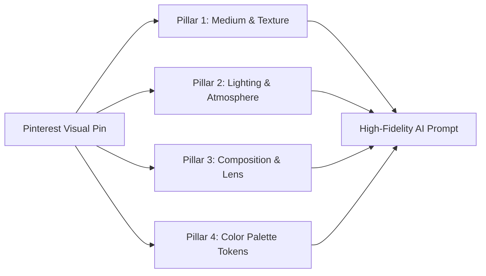

# AI Image Generation: Prompt Crafting from Pinterest Inspiration

This guide details how AI Agents convert Pinterest moodboards, visual reference tokens, and dominant colors into photorealistic or artistically intentional image generation prompts for **Midjourney v6+**, **Google Gemini ImageGen / Imagen 3**, and **DALL-E 3**.

---

## 1. The 4-Pillar Deconstruction Method

Never write generic prompts like *"a coffee cup on a table, realistic, 8k"*. Instead, analyze the Pinterest pins across four visual pillars:



### Pillar 1: Medium, Texture & Surface
Identify the physical or digital substrate:
- **Photography**: 35mm film photography, Kodak Portra 400, Fujifilm Superia grain, Hasselblad medium format, polaroid snapshot, daguerreotype.
- **Digital Art / 3D**: Matte claymorphism, frosted translucent glass render, Octane studio lighting, brutalist wireframe, Bauhaus risograph print.
- **Tactile Details**: Uncoated textured cotton paper, visible canvas weave, micro-scratches, brushed aluminum, ceramic glaze crazing, linen fibers.

### Pillar 2: Lighting & Atmospheric Quality
Lighting dictates mood more than any other element:
- **Natural**: Soft diffused overcast Nordic daylight, golden hour low-angle rim lighting, dappled sunlight filtering through sheer curtains (*komorebi*), dusk twilight glow.
- **Studio**: Dramatic chiaroscuro with deep soft shadows, high-key clean beauty lighting, directional softbox with grid, single-source harsh spotlight.
- **Atmospheric Effects**: Volumetric dust motes, subtle morning mist, wet asphalt reflections, atmospheric fog, lens flare.

### Pillar 3: Composition, Framing & Lens Perspective
Derive framing directly from the pin's `aspect_ratio` and visual balance:
- **Lens Specs**: 35mm street documentary, 85mm f/1.4 portrait with creamy shallow depth of field, 24mm architectural tilt-shift, 100mm macro detail.
- **Compositional Rhythm**: Heavy negative space, off-center rule-of-thirds, Dutch angle tension, dynamic diagonal flow, symmetric Swiss grid framing.
- **Aspect Ratio Alignment**:
  - Pinterest portrait pins (`aspect_ratio ~ 0.56 – 0.75`): `--ar 4:5` or `--ar 9:16`
  - Square pins (`aspect_ratio ~ 1.0`): `--ar 1:1`
  - Landscape pins (`aspect_ratio ~ 1.5 – 1.77`): `--ar 16:9` or `--ar 3:2`

### Pillar 4: Color Palette & Mood Tokens
Translate extracted `dominant_color` hex codes into rich, evocative color terminology:
- Rather than saying "brown and orange", say: *"Rich roasted espresso brown (`#2C1E17`), weathered caramel ochre (`#8C6546`), and accents of sun-baked terracotta clay (`#C15C3D`)"*.
- Specify tonal grading: *desaturated matte finish, warm analog tones, monochromatic slate gradation, muted pastel hues*.

---

## 2. Prompt Formula Architectures

### A. Midjourney v6 / v6.1 Formula

```
[Core Subject & Key Action], [Medium, Substrate & Camera Specifics], [Lighting Setup & Atmosphere], [Color Palette & Tone Descriptors], [Editorial or Contextual Vibe] --ar [ratio] --style raw --v 6.1 --stylize [50-250]
```

#### Key Midjourney Flags:
- `--v 6.1`: Uses the latest state-of-the-art photorealism model.
- `--style raw`: Reduces over-processed AI aesthetic; respects exact photographic instructions.
- `--stylize 75`: (Default 100) Lower values (50–100) follow the prompt strictly; higher values (150–250) add creative flair.
- `--ar X:Y`: Aspect ratio derived from Pinterest reference.

---

### B. Google Gemini ImageGen / Imagen 3 Formula

Imagen 3 favors clear, descriptive natural language sentences over fragmented parameter tags:

```
A high-resolution photograph capturing [Subject and context]. Captured on [Medium/Camera setup], the scene features [detailed lighting conditions] creating [shadow quality and mood]. The color palette is dominated by [Color 1], [Color 2], with subtle accents of [Color 3]. The composition utilizes [framing/depth-of-field], highlighting the tactile texture of [surfaces].
```

---

## 3. Real-World Conversion Walkthroughs

### Example 1: Artisanal Organic Coffee Branding

- **Pinterest Search**: `artisanal coffee shop packaging editorial warm earthy`
- **Extracted Tokens**:
  - Dominant Colors: `#2C1E17` (Deep Bean), `#8C6546` (Caramel Ochre), `#F4EFEA` (Oatmeal Cream), `#C15C3D` (Terracotta)
  - Style: Tactile, organic, minimalist Japanese-Nordic cafe
  - Lighting: Soft morning daylight with gentle shadows

#### Midjourney Prompt:
```
An artisanal pour-over coffee setup on a raw travertine stone counter, ceramic dripper with freshly brewed dark roast coffee, unbleached kraft paper bag with minimalist embossed typography in the background. Shot on 35mm Kodak Portra 400, soft morning natural window light from the left, subtle steam rising. Color palette of deep espresso brown #2C1E17, warm caramel ochre #8C6546, and soft oatmeal cream #F4EFEA. Clean editorial still life composition, shallow depth of field --ar 4:5 --style raw --v 6.1 --stylize 80
```

#### Gemini / Imagen 3 Prompt:
```
A high-end editorial still-life photograph of an artisanal pour-over coffee ritual. A handmade matte ceramic dripper rests atop a clear borosilicate glass server on a textured cream travertine tabletop. Gentle morning sunlight pours through a sheer linen curtain, casting soft, elongated shadows. The color harmony features rich dark espresso browns, warm caramel tones, and textured oat-cream neutrals with a small terracotta accent pill. Shot with an 85mm prime lens at f/2.0, emphasizing organic paper textures, steam wisps, and delicate water droplets.
```

---

### Example 2: Neo-Tokyo Cyberpunk Editorial Poster

- **Pinterest Search**: `cyberpunk graphic design typography poster neon chiaroscuro`
- **Extracted Tokens**:
  - Dominant Colors: `#0B0C10` (Obsidian), `#1F2833` (Slate Steel), `#C5A880` (Champagne Gold), `#45A29E` (Cyber Teal), `#E63946` (Signal Red)
  - Style: Swiss typographic poster meets retro-futuristic manga
  - Lighting: Dramatic edge neon lighting, rain reflections, volumetric smog

#### Midjourney Prompt:
```
A cinematic editorial fashion portrait of a cybernetic courier in a wet Tokyo alleyway at night, wearing an oversized matte techwear parka with Japanese typographic patches. Dramatic cyan #45A29E and signal red #E63946 rim lighting against deep obsidian shadows #0B0C10, wet pavement reflecting neon signage, volumetric rain mist. Shot on 50mm anamorphic lens, gritty 35mm film grain, high-contrast chiaroscuro, graphic design poster aesthetic with generous negative space --ar 3:4 --style raw --v 6.1 --stylize 120
```

---

### Example 3: Minimalist Architecture & Interior

- **Pinterest Search**: `scandinavian modern living room boucle sofa soft natural lighting`
- **Extracted Tokens**:
  - Dominant Colors: `#EBE7DF` (Alabaster), `#B8ADA0` (Taupe Stone), `#3B3531` (Dark Walnut)
  - Style: Wabi-sabi minimalist interior, architectural digest feature
  - Lighting: Overcast daylight, diffuse bounced illumination

#### Midjourney Prompt:
```
Architectural Digest interior photography of a minimalist living room with curved cream boucle sectional sofa, round raw oak coffee table with a single fluted ceramic vase, polished microcement floors. Expansive floor-to-ceiling glass wall looking out to a misty pine forest. Soft diffuse overcast daylight, zero harsh shadows. Neutral color palette of alabaster white #EBE7DF, warm taupe stone #B8ADA0, and muted walnut accents #3B3531. Shot on Hasselblad medium format 24mm tilt-shift lens, perfectly straight vertical lines, serene atmospheric quietude --ar 16:9 --style raw --v 6.1 --stylize 90
```

---

## 4. Anti-Slop Guardrails (What to Avoid)

### ❌ The Banned Clichés
Never include these outdated buzzwords. Modern diffusion models (Midjourney v6, Imagen 3, FLUX) treat them as noise or over-saturate results:
- `8K`, `16K resolution`, `hyperrealistic`, `ultra-realistic`
- `trending on ArtStation`, `Unreal Engine 5 render`, `octane render` (unless literally asking for 3D game assets)
- `masterpiece`, `award-winning`, `insanely detailed`

### ❌ Visual Flaws to Eliminate
1. **Waxy / Plastic Skin**: Prevent by specifying camera film stock (*"natural skin texture, visible pores, 35mm film grain"*).
2. **AI Purple-Cyan Default**: Overcome by feeding the explicit `dominant_color` hex codes and descriptive color tokens into the prompt.
3. **Centered Flat Symmetry**: Prevent by specifying deliberate composition (*"asymmetrical framing, dynamic diagonal lead lines, generous negative space on upper third"*).

### Recommended Negative Prompts (or `--no` parameters):
```
--no oversaturated, cartoon, plastic skin, CGI, 3D render, deformed hands, watermark, blurry, generic stock photo
```
